# Tom Secrets Manager in the browser: user guide

This guide is for the person who uses the Tom Secrets Manager extension in
Chrome, Edge, Brave, Chromium, Firefox or Safari: installing it, filling a
login, saving a new one, and passkeys. The labels in quotes are the ones
the extension shows. The [package README](../README.md) and the
[extension's README](../extension/README.md) are the developers'
reference.

The pictures show the extension in Chromium on a demo login page, with
demo logins.

## Contents

- [How it fits together](#how-it-fits-together)
- [Installing](#installing)
- [Approving the browser](#approving-the-browser)
- [Filling a login](#filling-a-login)
- [What the list can say](#what-the-list-can-say)
- [Saving a login](#saving-a-login)
- [Passkeys](#passkeys)
- [Privacy](#privacy)

## How it fits together

This diagram shows the pieces between a web page and your vaults.


<!-- diagram 1-pieces
```mermaid
flowchart LR
  subgraph browser["The browser"]
    page["Web page<br/&gt;login form"]:::client
    ext("Extension<br/&gt;the shield, the list, the bar"):::program
  end
  subgraph machine["This machine"]
    host("tsm-browser-host"):::program
    svc("Secrets service"):::program
    app("Manager app"):::program
    vaults[("Vaults")]:::vault
  end
  page -- the fields --&gt; ext
  ext -- native messaging --&gt; host
  host -- client endpoint --&gt; svc
  svc -- prompts, proposals --&gt; app
  svc --&gt; vaults
  class browser zoneSandbox
  class machine zoneDevice
```
-->

- **The extension** finds the login fields of a page, shows the list of
  your logins for the site, and fills the one you pick. It asks for
  nothing on its own: it talks only to the host.
- **The host**, `tsm-browser-host`, is a small program the browser starts
  for the extension. It ships with the app, beside the service, and
  answers only the Tom Secrets Manager extension.
- **The service** decides which logins the browser may see and hands out
  a value only for the login you picked on that page.
- **The app** asks you to approve the browser the first time, and keeps
  the logins the browser offers to save.

The flows document draws the list, the fill, the approval and a saved
proposal step by step:
[the browser](https://github.com/al-the-bear/tom_secrets_manager/blob/main/doc/flows.md#the-browser).

## Installing

The desktop app must be installed (its user guide says how); the host
comes with it.

**To install the extension in Chrome, Edge or Brave:**

1. Install it from its store entry. The entries are unlisted: only their
   link finds them.
2. Or load it unpacked: build the extension from source (`npm ci` and
   `npm run build` in `tom_secrets_browser/extension`), open
   `chrome://extensions` (`edge://extensions`, `brave://extensions`),
   switch on "Developer mode", choose "Load unpacked" and pick
   `dist/chromium`. Chrome on Windows and macOS keeps an unpacked
   extension only while Developer mode is on.
3. Pin it to the toolbar from the puzzle-piece menu, if you like.

**To install it in Firefox** (128 or later):

1. Download the signed package (`.xpi`). Firefox installs only add-ons
   Mozilla has signed.
2. Open `about:addons`, choose the gear menu › "Install Add-on From
   File…" and pick the package; confirm the permissions.
3. To try a build from source instead, open
   `about:debugging#/runtime/this-firefox`, choose "Load Temporary
   Add-on…" and pick `dist/firefox/manifest.json`; it stays until Firefox
   quits.

**To install it in Safari** (macOS, Safari 17 or later): the extension
comes inside the team-signed manager app; the ad-hoc signed app has none.

1. Install the team-signed app.
2. Open Safari › Settings › Extensions and switch on "Tom Secrets Manager".
3. Allow it on all websites when Safari asks (or under "Edit Websites…").

**To turn the browser on in the app** (Chrome, Chromium, Edge, Brave and
Firefox; Safari needs no step here):

1. Open the manager app's Settings › Integrations › Browsers.
2. Switch on the browser. The app writes the file that lets that browser
   start the host (on Windows also a registry value).

A browser installed as a Flatpak or a Snap on Linux is named there but not
offered: its sandbox cannot start the host. At every start the app checks
the browsers it switched on and repairs what an update moved.

## Approving the browser

The first time the extension looks up a site's logins in a browser, the
app asks: "The browser extension asks for logins" names the page, the
browser and the site's logins. Meanwhile the list says it is asking.

- **"This time"**: the extension may list the site's logins and fill each
  once in the next ten minutes.
- **"Always in this browser"**: approves that browser for good (another
  browser asks on its own). What it covers is chosen in the prompt: "These
  logins", "Their vaults" or "All logins".
- **"Never"**: the browser gets nothing.

With the app closed, nothing is asked and the list shows no login. A
browser you refused, or want to approve again, is under the app's Clients ›
Allow list ("Revoke"). Logins of system vaults are never given to a
browser.

## Filling a login

A small shield sits at the right edge of a login page's user-name and
password fields.

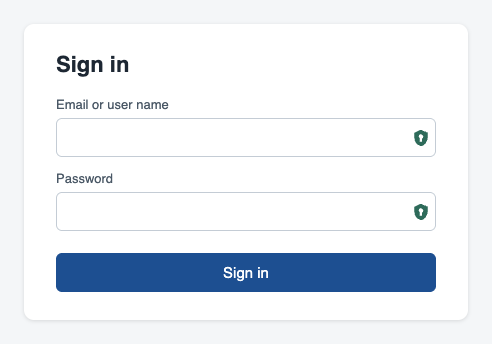

**To fill a login:**

1. Open the list at the field, one of four ways:
   - click the shield in the user-name or password field;
   - press Ctrl+Shift+L (Command+Shift+L on macOS) in the field;
   - right-click the field and choose "Fill from Tom Secrets Manager";
   - click the extension's toolbar button (the popup).
2. Pick the login and choose "Fill". The extension fills the user name and
   the password into that form, and the current one-time code when the form
   has a field for it.
3. Sign in as usual. Escape closes the list without filling.

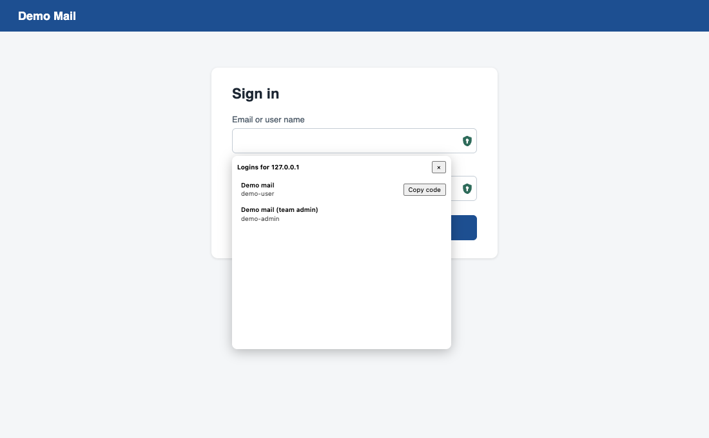

The list shows each login of the site: its title, the user name, and the
address it matched. Once there are more than five, a filter narrows it.

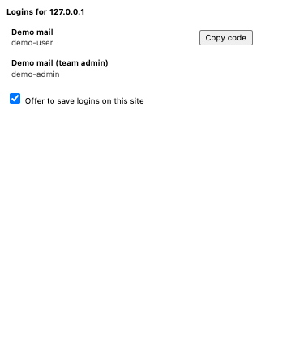

The popup fills the tab's top frame; a form inside a frame is filled from
the list at its field.

**To use a one-time code:** a login with a one-time code (TOTP) shows "Copy
code" in the list; it copies the current code, which you paste into the
site's code field. A form that asks for the code together with the password
gets it filled with them.

**A login form in a frame of another site** (a payment page or a sign-in
frame) shows nothing at first, because the logins match the page's own
site. The list then offers "Show the logins of `<site>`": choose it, and it
lists the logins of the frame's site, to be filled into that frame only.

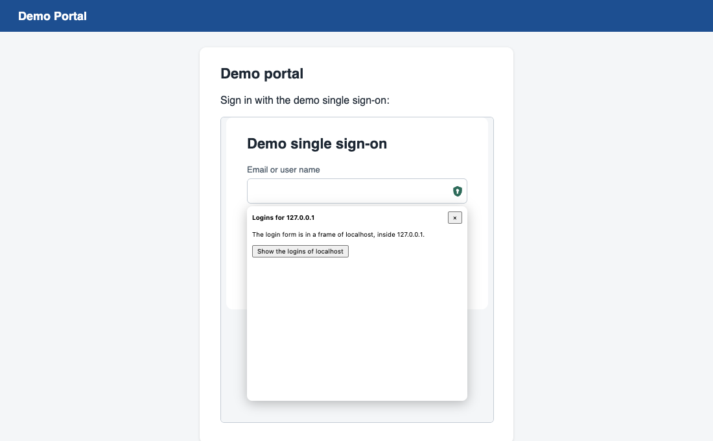

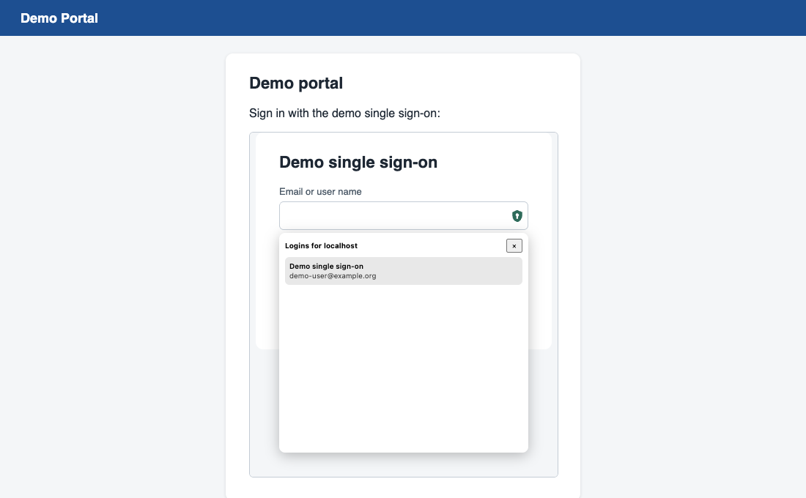

**To use a suggested password** in a sign-up or password-change form:

1. Click the shield in the first new-password field.
2. The list shows a strong password (20 characters, upper and lower case,
   digits and symbols). "Another" makes a new one.
3. Choose "Use this password": it is filled into the form's new-password
   fields.
4. Submit the form; the extension then offers to save the login (below).

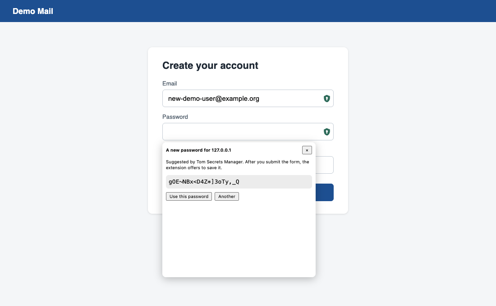

## What the list can say

| The list says | Why | What to do |
| --- | --- | --- |
| "Asking Tom Secrets Manager… It may ask you to approve this browser." | the extension waits for the service, which may be asking you in the app | answer in the app |
| "Tom Secrets Manager is locked." with "Unlock in Tom Secrets Manager" | the service is locked | choose it and unlock in the app; the list then shows the logins |
| "Tom Secrets Manager is not running." with "Open Tom Secrets Manager" | the service is not running | choose it; the app opens and starts the service |
| "the browser host is not installed for this browser: turn it on in Tom Secrets Manager › Settings › Integrations › Browsers" | the browser is not switched on in the app | switch it on there |
| "No login of this site that this browser may use." | the vaults hold none for the site, the app is closed, or the browser was refused | add a login in the app, open the app, or revoke the refusal under Clients › Allow list |

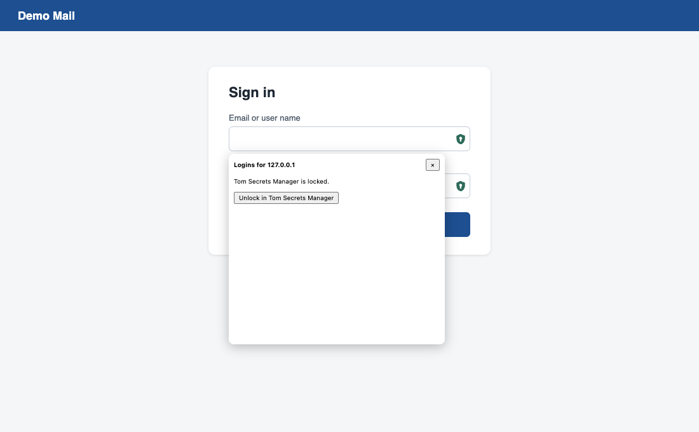

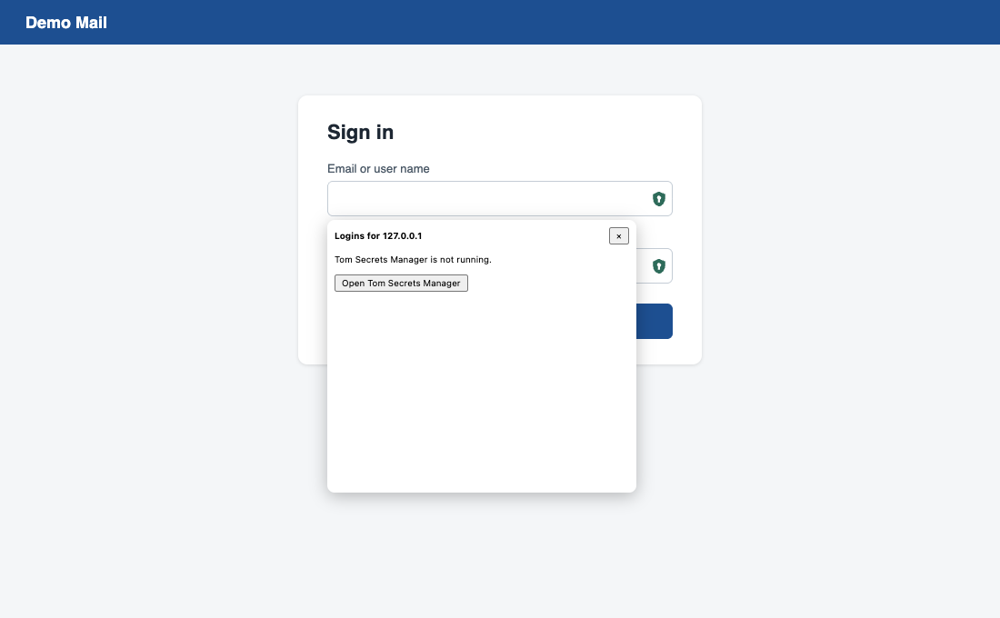

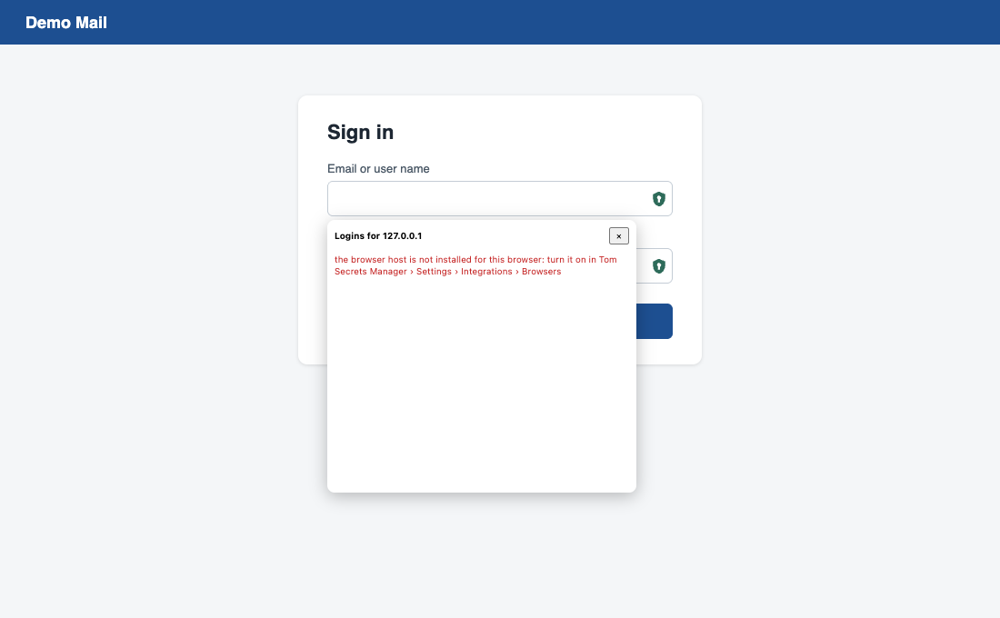

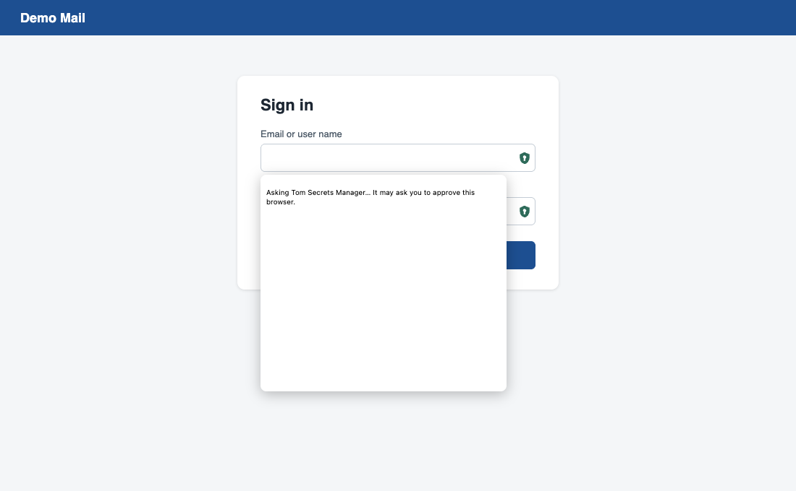

The popup shows the same states:

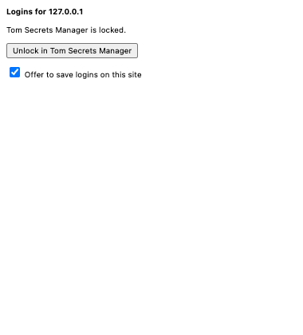

## Saving a login

When you sign in with a login the vaults do not hold, or change a password,
the bar "Save in Tom Secrets Manager?" appears at the top of the tab, also
on the page the form led to. It names the site and the user name, never the
password.


A changed password asks "Update the password of … for …?":

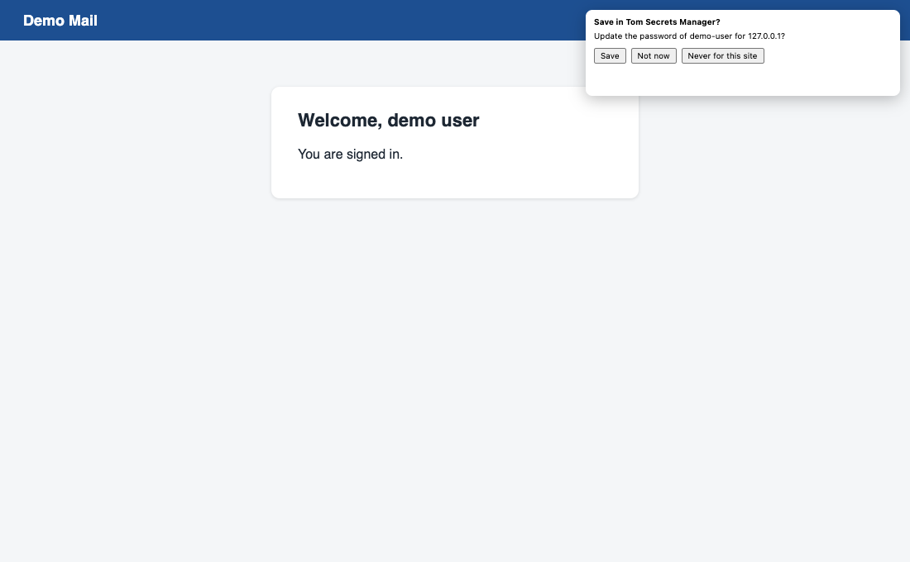

**To save it:**

1. Choose "Save" in the bar. The login goes to the app, and the bar says
   "Sent to the app: save it there under Proposals."

   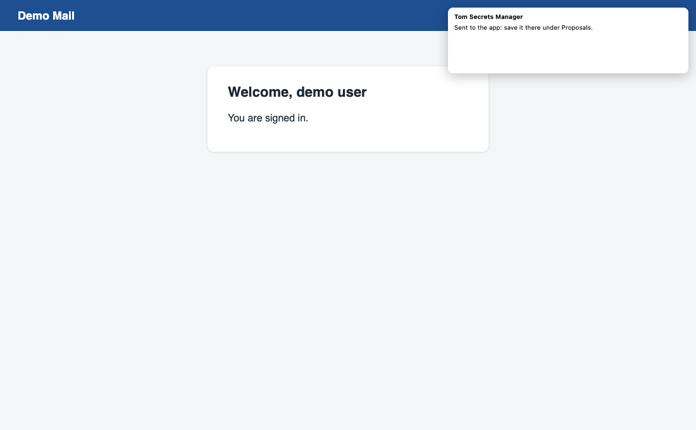

2. In the app, open Proposals (its badge counts them): save it as a new
   login in a vault of your choice, or update the existing login of that
   site and user (the old password goes to its history); or drop it.

"Not now" drops it. "Never for this site" stops the bar for that site; the
toolbar button's "Offer to save logins on this site" turns it on again.

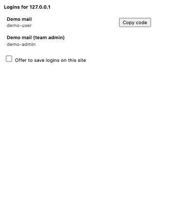
Saving needs "Always in this browser": a browser approved "This time" is
refused. The extension holds the password only until you answer the bar,
close the tab, or two minutes pass; the app keeps proposals in memory only,
until you answer them or lock.

## Passkeys

In Chrome 111, Edge, Brave and Firefox 128 or later, the extension answers
a site's passkey requests from your vaults. In Safari, passkeys go through
the app's Password AutoFill instead.

**To sign in with a passkey:**

1. On the site, choose its passkey sign-in.
2. When your vaults hold a passkey for the site, the extension's list
   opens at the top right of the page: "Sign in to … with a passkey".
3. Pick the passkey. The service signs, and the site signs you in.

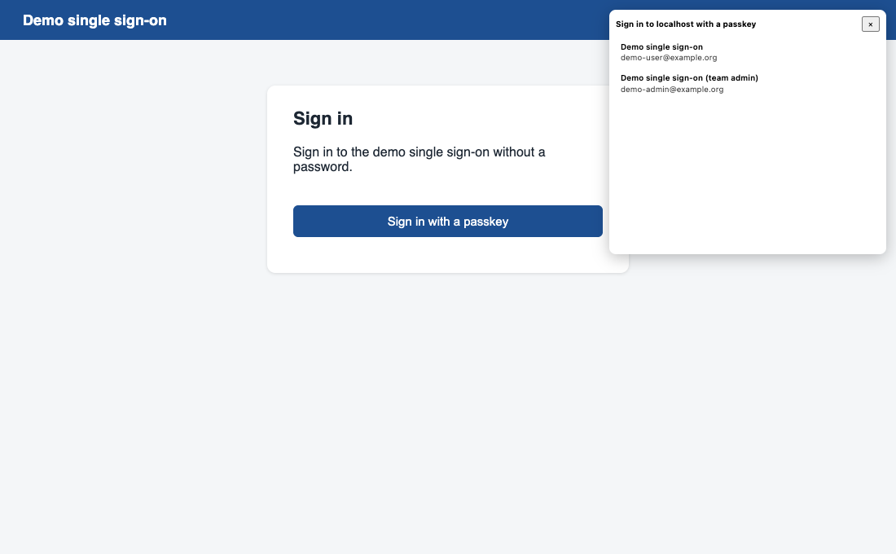

The first time, the app asks you to approve the browser for the site's
passkeys ("The browser extension asks for passkeys").

**To create a passkey:** start it on the site; the app asks "Save a passkey
for …?". "Save in Tom Secrets Manager" keeps it in the login of that site
and user (or a new login), and every device has it from there. "Not now"
lets the browser offer its own.

**The browser's own passkeys** answer when you close the list, when the
vaults hold none for the site, or when the app is locked or closed; the
browser then shows its own dialog (a phone, a security key, its own store).

## Privacy

- **Nothing fills by itself.** A value goes into a page only when you pick
  a login and choose "Fill" or "Use this password".
- **The page sees nothing of the list.** The list, the bar and the
  passkey list are the extension's own pages in a closed frame: the page
  can neither read nor restyle them.
- **The site is the browser's word.** The logins are matched against the
  address the browser reports for the page and the frame, never what the
  page claims; a value is filled only into the frame the list was opened
  for.
- **The extension sees** the login fields of the pages you visit, the list
  of a site's logins (titles, user names, addresses), and the values of the
  one login you fill. It stores only the sites you set to "Never for this
  site"; no password, code or entry.
- **The host sees** the requests of the extension and the service's
  answers; it keeps nothing. To decide whether to offer saving a login it
  compares the submitted password with the stored one itself and tells the
  extension only "new", "changed" or "known".
- **A passkey's key** never leaves the service: it signs, and the extension
  passes the signature on.
- **System vaults** (the fleet's secrets) never reach a browser.
