# The build and release tool: maintainer's guide

This guide is for the maintainer who checks, builds and releases the Tom
Secrets Manager with `tom_secrets_build`: what its manual CI does, how to
run it, how to read what it says, and how a release is made, signed and
published. The package's [README](../README.md) is the reference for every
stage's details.

The blocks starting with `$` are real runs, shortened (`…`), with the
repositories cloned side by side under `/home/demo/src`.

## Contents

- [A manual CI](#a-manual-ci)
- [Getting the three repositories](#getting-the-three-repositories)
- [The stages](#the-stages)
- [Reading what it says](#reading-what-it-says)
- [Making a release](#making-a-release)
- [Signing](#signing)
- [Publishing to tom_binaries](#publishing-to-tom_binaries)
- [When a check is red](#when-a-check-is-red)

## A manual CI

`tom_secrets_build` analyzes and tests every package of the product's three
repositories, runs the licence-boundary, conformance, standalone and
documentation checks, and builds the releases. It runs one step after
another and keeps every log.

**A person starts it, from a clone.** There is no CI on GitHub: Actions is
switched off for the product's repositories, and nothing schedules a run
(no workflow, crontab, launchd agent, systemd timer or git hook). The
reasons:

- the product's builds need machines GitHub's runners are not: a Mac with
  Xcode, a Windows machine with the Windows SDK, a Linux desktop, real
  keychains and a running secrets service for the integration suites;
- the signing keys stay on the maintainer's machines;
- a run is something a person decides on and reads, not a background job.

## Getting the three repositories

**To set it up:**

1. Clone the three repositories side by side:

   ```sh
   mkdir -p ~/src && cd ~/src
   git clone https://github.com/al-the-bear/tom_app_secrets_manager.git
   git clone https://github.com/al-the-bear/tom_secrets_manager.git
   git clone https://github.com/al-the-bear/tom_secrets_clients.git
   ```

2. Install the Flutter SDK (it brings Dart). For the stages that need them:
   Node.js 20 or later with npm, Python 3 with `jsonschema`, Go, Rust with
   `cargo` and `clippy`, a JDK 16 or later, CMake 3.16 or later with a C
   compiler; Docker for `:relay`; the Android SDK for `:mobile`.
3. Run it from `tom_app_secrets_manager/tom_secrets_build`:

   ```sh
   cd ~/src/tom_app_secrets_manager/tom_secrets_build
   ./ci.sh --help
   ```

   On Windows: `.\ci.ps1` in PowerShell, or `ci.cmd` in cmd.exe.

Elsewhere than side by side, name the two other repositories in
`tom_secrets_build/repositories.yaml`:

```yaml
secrets_manager: ../../other/tom_secrets_manager
secrets_clients: ../../other/tom_secrets_clients
```

A repository that is not found is a red step of every stage.

## The stages

This diagram shows the stages in the order `:all` runs them, and the three
that only run when named.



<!-- diagram 1-stages
```mermaid
flowchart LR
  subgraph all[":all, in order, past a red"]
    analyze(":analyze"):::program
    test(":test"):::program
    integration(":integration"):::program
    licences(":licences"):::program
    conformance(":conformance"):::program
    standalone(":standalone"):::program
    docs(":docs"):::program
  end
  subgraph named["Only when named"]
    release(":release"):::program
    mobile(":mobile"):::program
    relay(":relay"):::program
  end
  analyze --&gt; test --&gt; integration --&gt; licences
  licences --&gt; conformance --&gt; standalone --&gt; docs
  class all zoneDevice
  class named zoneRemote
```
-->

| Stage | What it does | Run it |
| --- | --- | --- |
| `:analyze` | analyzes and builds every package: Dart, npm, Cargo, CMake, Maven, Go, Python, and on macOS the AutoFill provider's target | after every change |
| `:test` | every package's tests | after every change |
| `:integration` | the integration suites against the real service | before a release; after a change to the service or `tsm` |
| `:licences` | the licence-boundary check | after a dependency changed |
| `:conformance` | every client against the protocol's case tables | after a change to the protocol or a client |
| `:standalone` | nothing in the tracked files depends on the maintainers' workspace | before every push |
| `:docs` | the documentation check: diagrams, links, line length, the configuration reference | after a change to a document |
| `:all` | the seven above, in order, going on past a red one | before a release, and whenever unsure |
| `:release` | the release of the platform it runs on | to make a release |
| `:mobile` | the Android app's signed APK | to release the mobile app |
| `:relay` | the relay server's container image | to deploy the relay |

Several stages can be named at once (`./ci.sh :standalone :docs`); they run
in the order given. `./ci.sh :all` takes a while; while working, run the
stages the change touches.

## Reading what it says

Each run prints a header, one line per step as it ends, and as its last
line the summary:

```text
$ ./ci.sh :standalone :licences
tom_secrets_build :standalone :licences
  logs    tom_secrets_build/testlog/20261124-193605
  lock    /home/demo/src/ztmp/flutter.lock
  flutter /home/demo/flutter/bin/flutter
== :standalone — the standalone check over the three repositories' tracked files: …
[standalone] … green +7 (3s)
== :licences — pub get in every package, then the licence-boundary check: …
[licences] pub get … green  (9s)
[licences] tom_app_secrets_manager/tom_secrets_browser/extension npm ci … green  (3s)
[licences] tom_app_secrets_manager/tom_secrets_build npm ci … green  (25s)
[licences] tom_secrets_clients/clients/typescript npm ci … green  (1s)
[licences] tom_secrets_clients/clients/rust cargo fetch … green  (0s)
[licences] tom_secrets_clients/conformance/runners/rust cargo fetch … green  (0s)
[licences] licence boundary … green +32 (3s)
CI GREEN: standalone licences — 8 steps, 0 red, in 47s — logs tom_secrets_build/testlog/20261124-193605
```

- **Each step line:** the stage, the step (a package or a check), green or
  red, the passed tests (`+32`) and the time.
- **The summary line:** `CI GREEN …` or `CI RED …`, naming every red step
  and its log. The exit code is non-zero when any step is red.
- **The logs:** `testlog/<timestamp>/`, one file per step, plus
  `summary.txt` with the step lines and their log files. A log starts with
  the command, its folder and time, holds everything it printed, and ends
  with `[exit <code>]`.

```text
$ cat testlog/20261124-193605/summary.txt
green  standalone  3s  +7  tom_secrets_build/testlog/20261124-193605/standalone.log
green  licences pub get  9s    tom_secrets_build/testlog/20261124-193605/licences.pub-get.log
…
green  licences licence boundary  3s  +32  tom_secrets_build/testlog/20261124-193605/licences.boundary.log
```

**The flutter lock.** Every child process runs under one lock file, so two
runs (or two sessions on one machine) never run Flutter at once; a second
run waits.

## Making a release

A release is made on each platform, from the same commit, with
`./ci.sh :release`. It builds:

1. the service, `tsm`, and the browser host;
2. the browser extension's store packages (Chromium and Firefox ZIPs);
3. the desktop app, with `tsm`, the service and the browser host in its
   `tsm` folder;
4. the archives: `tom_secrets_manager-<version>-<platform>` (the app) and
   `tom_secrets_tsm-<version>-<platform>` (the tools alone, for a
   server), as `.zip` (`.tar.gz` on Linux), with `SHA256SUMS`;
5. a smoke run: the assembled `tsm` starts and unlocks the assembled
   service on a demo installation, reads its status and stops it.

Everything lands in `tom_secrets_build/release/<version>/` (ignored by
git); the version is `tom_secrets_app`'s.

**To make the release of every platform:**

1. Run `./ci.sh :all` and see it green.
2. On a Mac (Apple silicon): `./ci.sh :release`.
3. On a Linux x64 desktop: `./ci.sh :release` (the tray needs
   `libayatana-appindicator3-dev`).
4. On Windows x64: `.\ci.ps1 :release` (Visual Studio with ATL and the
   Windows SDK 10.0.26100; CMake on `PATH`). It also builds the passkey
   plugin and the MSIX package (below).
5. For the phone: `./ci.sh :mobile` anywhere with the Android SDK.
6. Start the app from each archive once on a clean account and walk the
   First run.

## Signing

**Android** (`:mobile`): the APK is signed with the release key a
properties file names, outside every repository:

```properties
storeFile=/home/demo/keys/tsm-release.jks
storePassword=…
keyAlias=tsm
keyPassword=…
```

```sh
TSM_ANDROID_SIGNING=/home/demo/keys/tsm-android.properties ./ci.sh :mobile
```

Without a complete file the stage is red; it never signs with the debug
key. Keep the key and its passwords backed up: an app signed with another
key cannot update the installed one.

**Windows** (`:release`): the MSIX package is signed with a self-signed
certificate.

1. Make it once, in PowerShell (no administrator needed):

   ```powershell
   .\windows\new_signing_certificate.ps1 -OutDir C:\keys\tsm
   ```

   It writes the `.pfx`, the public `.cer` and a properties file
   (`certificateFile`, `certificatePassword`, `publisher`).
2. Name the properties file when releasing:

   ```powershell
   $env:TSM_WINDOWS_SIGNING = 'C:\keys\tsm\signing.properties'
   .\ci.ps1 :release
   ```

   Without a complete file the step `msix signing` is red; the package is
   never left unsigned.
3. Each machine that installs the package trusts the certificate once, as
   an administrator:
   `.\windows\install_signing_certificate.ps1 -Certificate tsm-signing.cer`.

**macOS**: `:release` signs the app bundle ad-hoc (`codesign -s -`); it is
not notarised, so users open it the first time with Control-click › Open.
The AutoFill provider and the Safari extension need the Apple Developer
team: the team is named in `tom_secrets_app/macos/Runner/Configs/
Autofill.xcconfig` (`TSM_TEAM_ID`), and that build is made and signed in
Xcode with the team's provisioning profiles. `:release` makes the ad-hoc
build only, and `:analyze` compiles both targets unsigned.

## Publishing to tom_binaries

A release is one GitHub release of the `al-the-bear/tom_binaries`
repository, tag `tom_secrets_manager-v<version>`, with every platform's
archives, the extension's packages, the APK and one combined `SHA256SUMS`.

**To publish:**

1. Gather `release/<version>/` from each platform's machine into one
   folder.
2. Combine the checksums: `cat */SHA256SUMS | sort -k2 -u > SHA256SUMS`,
   and check them with `shasum -a 256 -c SHA256SUMS`.
3. Create the release:

   ```sh
   gh release create tom_secrets_manager-v<version> \
     --repo al-the-bear/tom_binaries --title "Tom Secrets Manager <version>" \
     ./*.zip ./*.tar.gz ./*.msix ./*.apk SHA256SUMS
   ```

Before the first release of a component, `tom_binaries`' `LICENSE` needs a
row for it.

## When a check is red

**The licence boundary** (`:licences`) is red when a package's closure
links something it may not:

- a dependency under a copyleft licence (the GPL family), or one whose
  licence it does not recognise, or without a `LICENSE`: replace the
  dependency, or ask its authors; never add an exception for GPL;
- a package other than `tom_secrets_core` declaring `tom_kdbx_store` or
  another KDBX library, or a client, the relay or the build linking KDBX:
  reach KDBX through `tom_secrets_core` only;
- a non-Dart manifest no closure check reads yet (a `go.mod` that requires
  something, a `pom.xml` with runtime dependencies): extend the check
  before adding such a dependency.

The log names the package and what it links. An exception for a
file-level copyleft (as `dbus`, MPL-2.0, on Linux) is named in
`secretsLicenceExceptions` with its reason; the check prints it on every
run and turns red once it is no longer needed: remove it then.

**The standalone check** (`:standalone`) is red when a tracked file would
not build or read right outside the maintainers' workspace:

- a `path:` dependency into another repository: depend on the published
  version instead (publish it first);
- a `pubspec_overrides.yaml`: delete it and publish what it pointed to;
- a path of the maintainers' workspace (its folder names, machine names or
  binaries variable) in code or a document: write it as the user's own
  place, or as a relative path within the repository.

An exception is named in `secretsStandaloneExceptions` with why; it, too,
is printed on every run and turns red once no longer needed.

**Any other red step:** open its log (the summary line names it), fix the
cause, and run that stage again. Never loosen a check or skip a test to
make a run green.
