# Tom Secrets Manager — mobile app user guide

This guide is for the person who uses the Tom Secrets Manager on an iPhone,
an iPad or an Android phone or tablet: to look up and copy logins, edit
entries and generate passwords, with the vaults the desktop app keeps on
GitHub. It goes task by task; the labels in quotes are the ones the app
shows. The pictures show an Android phone with demo vaults; an iPhone
looks the same, with Face ID in place of the fingerprint.

## Contents

- [What the phone keeps](#what-the-phone-keeps)
- [Installing](#installing)
- [Setting the phone up](#setting-the-phone-up)
- [Unlocking and locking](#unlocking-and-locking)
- [Finding and copying a login](#finding-and-copying-a-login)
- [Editing](#editing)
- [Vaults in Files](#vaults-in-files)
- [Staying current](#staying-current)
- [Autofill on Android](#autofill-on-android)
- [Passkeys on Android](#passkeys-on-android)
- [Health](#health)
- [Shares](#shares)
- [Settings](#settings)
- [The token reminder and setting up again](#the-token-reminder-and-setting-up-again)
- [Troubleshooting](#troubleshooting)

## What the phone keeps

The vaults stay on GitHub. When you unlock, the phone fetches them into its
memory; when it locks, they are gone from it. The phone keeps only what
opens them: the key files, the repository keys and a GitHub token of its
own, in the iOS keychain or the Android keystore, and — once you unlocked
with the master password — the vault's key behind Face ID, Touch ID or your
fingerprint. The master password itself is never stored.

So the phone needs a connection to unlock (a vault you keep in Files, such
as iCloud Drive, is read from there instead). System vaults (the ones the
fleet reads) are shown but read-only here. iOS fills nothing into other
apps: you copy a login from this app and paste it. Every setting and what
the phone keeps where is in the
[configuration reference](https://github.com/al-the-bear/tom_secrets_manager/blob/main/doc/configuration.md#the-mobile-app).

## Installing

The app is installed without an app store.

**To install on Android** (Android 7 or later; the Autofill service needs
Android 8, passkeys Android 14):

1. Download `tom_secrets_mobile-<version>-android.apk` from the release
   (the release's `SHA256SUMS` holds its checksum).
2. Open the file on the phone. Android asks whether the app that opened it
   (the browser or Files) may install apps: allow it for that app.
3. Choose "Install". Play Protect may ask once about an unknown developer:
   choose to install anyway.

**To install on an iPhone or iPad** (iOS 15 or later; a Mac with Xcode and
Flutter):

1. In a clone of the `tom_app_secrets_manager` repository, run
   `flutter pub get` in `tom_secrets_mobile`, then open
   `tom_secrets_mobile/ios/Runner.xcworkspace` in Xcode.
2. Under the Runner target › Signing & Capabilities, choose your Apple ID's
   "Personal Team". If Xcode says the bundle identifier is not available,
   change it to one of your own.
3. Connect the device, choose it as the destination and choose Run (or run
   `flutter run --release` in `tom_secrets_mobile`).
4. On the device, the first time: switch on Settings › Privacy & Security ›
   Developer Mode (iOS 16 and later; the device restarts), then trust your
   developer app under Settings › General › VPN & Device Management.

A build under the free personal team starts for 7 days. Two days before,
the app shows "This build stops starting on *date*: install it again from
Xcode": connect the device and choose Run again. The vaults and the keys
stay as they were.

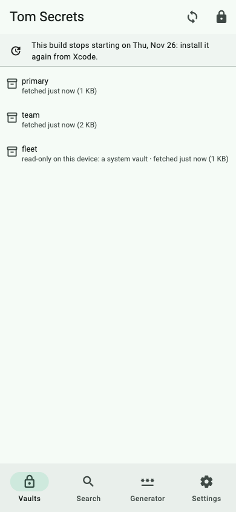

## Setting the phone up

The first screen is "Set up Tom Secrets Manager". The usual way is
**"Pair with a desktop"**: the desktop app sends the phone the vaults' keys
and its GitHub token. The flows document draws
[a phone scanning the QR code](https://github.com/al-the-bear/tom_secrets_manager/blob/main/doc/flows.md#a-phone-scanning-the-qr-code)
and the other routes.

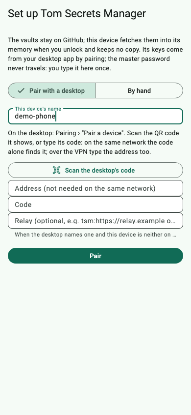

**To pair by scanning the desktop's QR code:**

1. On the desktop app, open **Pairing** and choose **"Pair a device"**. It
   shows a code, the addresses it listens on and a QR code.
2. On the phone, type "This device's name" (e.g. `iphone`).
3. Choose **"Scan the desktop's code"** and point the camera at the QR
   code. The first time, the system asks whether the app may use the
   camera: allow it. The phone fills the address (the one in its network)
   and the code: "Read from the desktop's code: tap Pair."
4. Choose **"Pair"**. iOS asks once whether the app may find devices on
   the local network: allow it.
5. On the desktop, tick the vaults the phone gets — the primary must be
   among them — and paste "A GitHub token for this device": a separate
   fine-grained token with read and write access to the vault repository,
   so you can revoke the phone alone. "Pair *name*" sends them.

**To pair by the code on the same network:** steps 1 and 2 as above, type
the "Code" the desktop shows, leave the address empty and choose "Pair":
the phone finds the desktop by the code. Then step 5.

**To pair over the VPN:** as by the code, and type the "Address" too: one of
the desktop's, with its port (e.g. `10.8.0.2:47900`).

**To pair through a relay**, when the phone is neither on the desktop's
network nor on the VPN:

1. On the desktop, choose the relay under "Also through a relay" before
   "Pair a device". Its QR code then names the relay.
2. On the phone, scan the QR code (it fills the "Relay" field), or type the
   relay and the code.
3. Choose "Pair", then finish on the desktop (step 5 above).

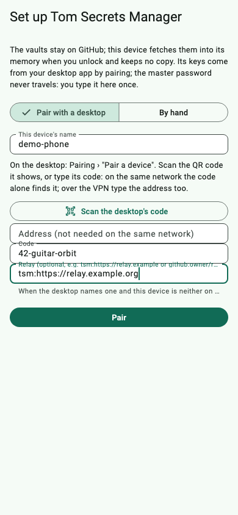

The relays:

- **A relay server** (`tsm:https://…`): no token is needed for the pairing
  itself; the desktop includes the GitHub token the phone uses for the
  vaults.
- **A magic-wormhole server** (`wormhole:ws://…`, for example the public
  `wormhole:ws://relay.magic-wormhole.io:4000/v1`) works the same way; the
  public one is run by volunteers and is not always up, so when it does not
  answer, pair through a relay server instead.
- **One of your vault repositories on GitHub** (`github:<owner>/<repo>`):
  paste **"This device's GitHub token for that repository"** — the phone
  needs one anyway. The phone keeps that token for the repository, so the
  desktop need not paste one there; the pairing takes some seconds longer
  than over the network.

With an address too, the address is tried first.

**To set up by hand** (a primary without a key file or outer encryption):

1. Choose **"By hand"**.
2. Type "This device's name", the "Primary vault"
   (`github:owner/repository/primary.kdbx`) and a "GitHub token".
3. Choose **"Set up"**.

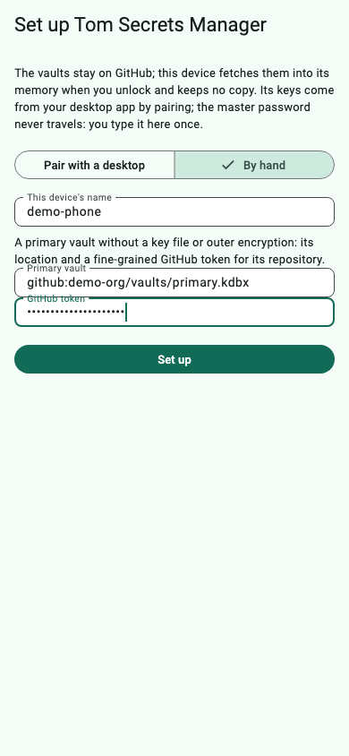

A primary with a key file or an outer encryption needs the pairing. Either
way, the unlock screen then asks for the master password, once.

## Unlocking and locking

**To unlock the first time:** type the master password and choose "Unlock".

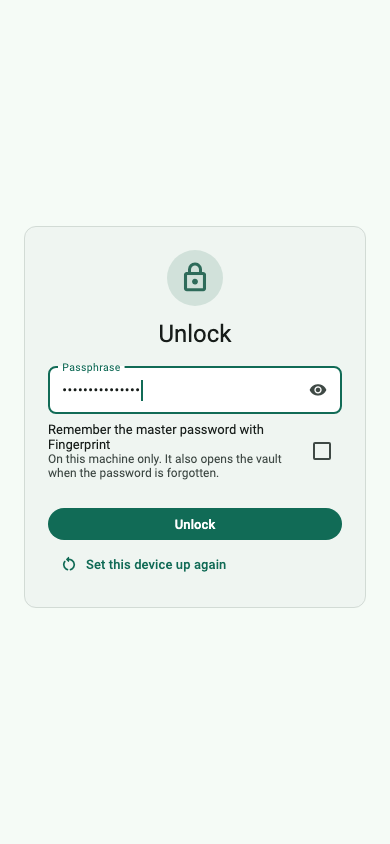

After it, the phone keeps the vault's key behind Face ID, Touch ID or your
fingerprint.

**To unlock later:** open the app; the system's Face ID, Touch ID or
fingerprint prompt appears at once on the unlock screen. Confirm it.

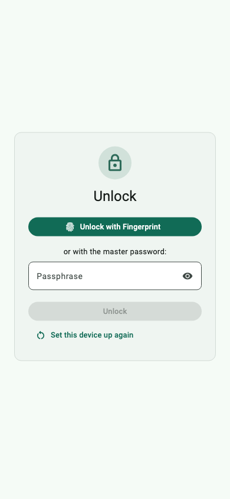

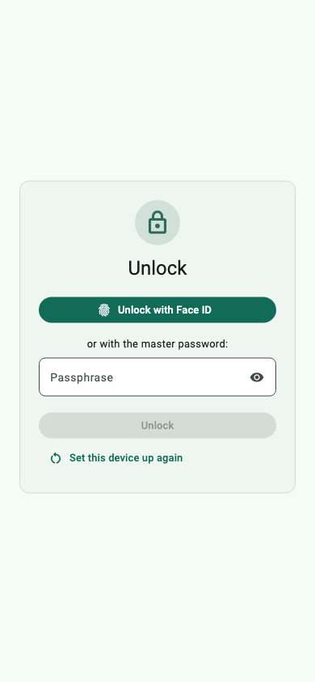

A changed fingerprint or face enrolment, or a master password changed on
another device, makes the phone ask for the password again.

**To lock:** choose the lock button at the top. The phone also locks:

- after it was in the background longer than the lock timeout (30 seconds
  by default, Settings › "Lock in the background after");
- when the app is closed.

While the app is in the app switcher, iOS shows a cover instead of its
screen, and Android shows none of it (and no screenshot of it can be
taken).

**Without a connection** the unlock says "No connection: the vaults are only
on GitHub. The unlock is tried again by itself when the network is back." —
leave the screen open; it opens once the phone is online (for ten minutes).

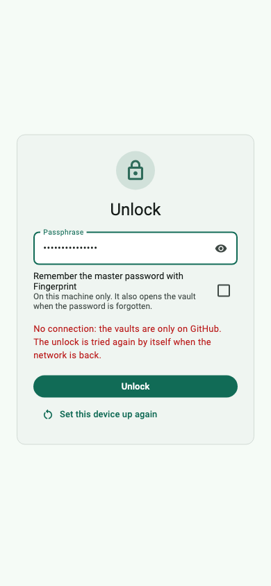

If the unlock says a vault "needs N MiB of memory to open", its key
derivation is set heavier than this phone can afford: open it in the desktop
app and lower its memory setting.

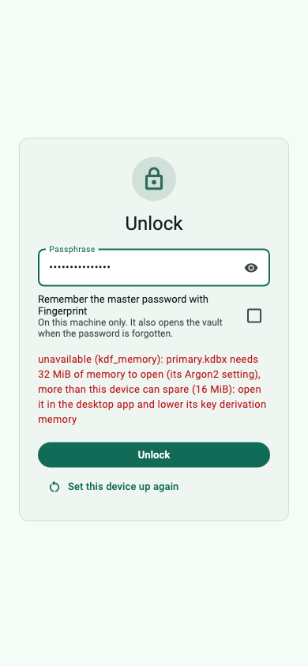

If GitHub refused this phone's token (it expired, or you revoked it), see
[setting up again](#the-token-reminder-and-setting-up-again).

## Finding and copying a login

On a phone, **Vaults** lists the vaults, each with what it is ("read-only on
this device: a system vault"), when it was fetched and how big the fetch
was (on mobile data every unlock fetches the vaults again), and the changes
not yet written. The bottom bar switches between Vaults, Search, Generator
and Settings.

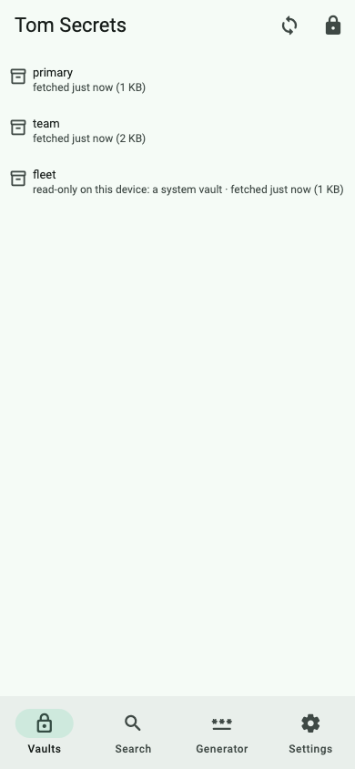

**To find a login:**

1. Tap a vault for its entries (or choose **Search**, which looks in every
   vault by title, user name, URL and key).
2. Tap the entry to open it.

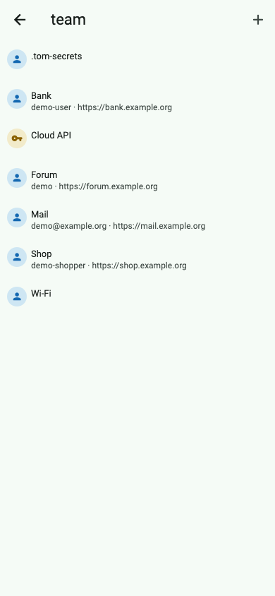

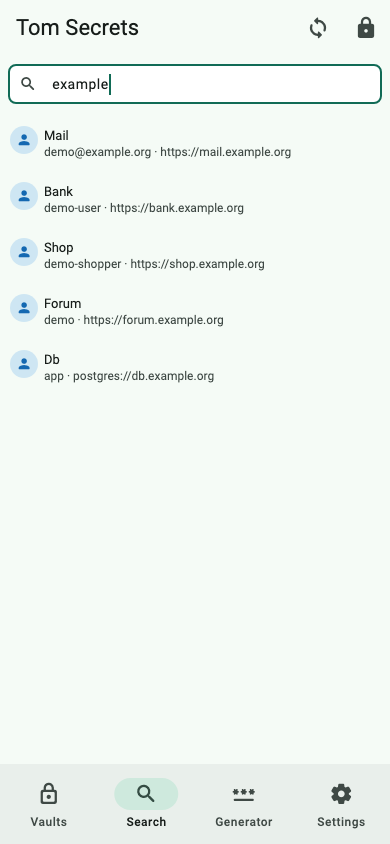

**To copy a password:** in the open entry, choose the copy button beside
the password (or the user name, or the one-time code).

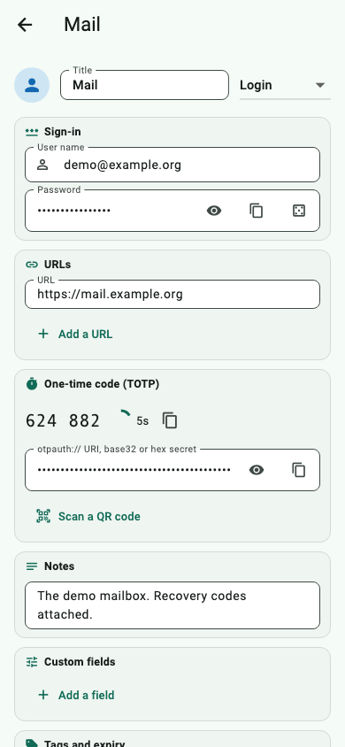

The value goes on the clipboard. It does not go to your other Apple
devices, and it is cleared after the clipboard timeout (30 seconds by
default). Android 13 and later hide it from the clipboard preview.

**To make a password for something outside the vaults:** choose
**Generator**, then "Generate", then "Copy".

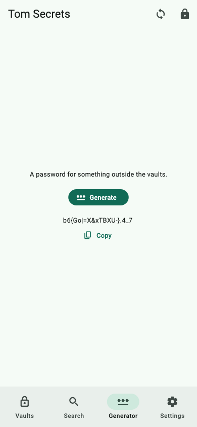

**On a tablet** the layout follows the width: up to 600 points it is the
phone's; from 600 to 900 the entry list and the entry stand side by side,
with a navigation rail; above 900 (an iPad upright, a tablet in landscape)
the desktop's tree, list and entry are shown.

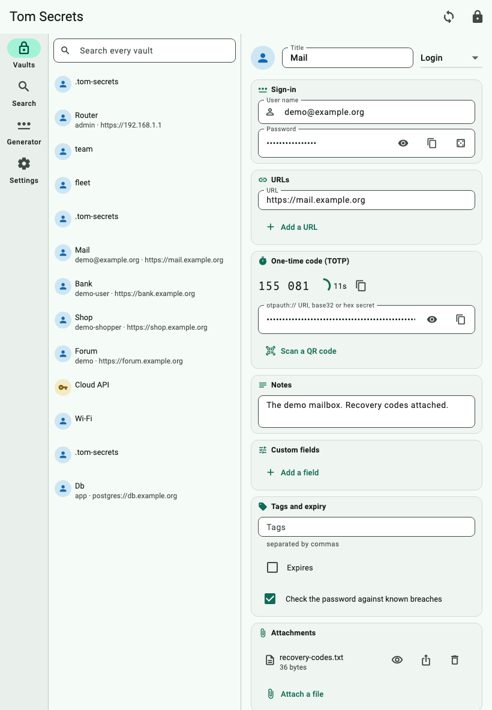

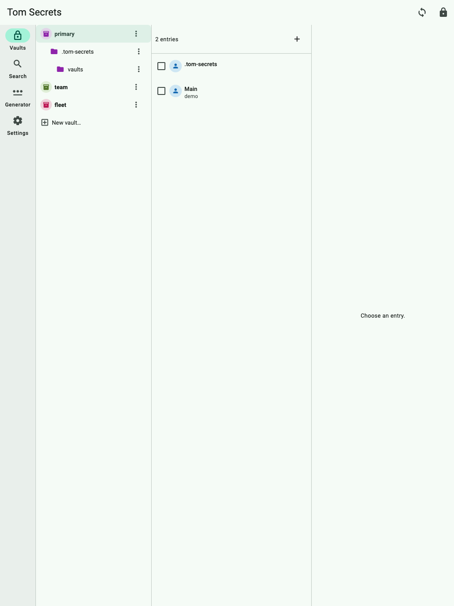

## Editing

Entries of your personal and shared vaults are edited as on the desktop:
the fields, the password generator, the one-time code, tags and notes.
System vaults are read-only on the phone: change them on a desktop.

**To add an entry:**

1. Open the vault's entry list.
2. Choose the **+** ("New entry") and give its title.
3. Fill in the fields and choose "Save". The dice button beside the
   password opens the password generator.

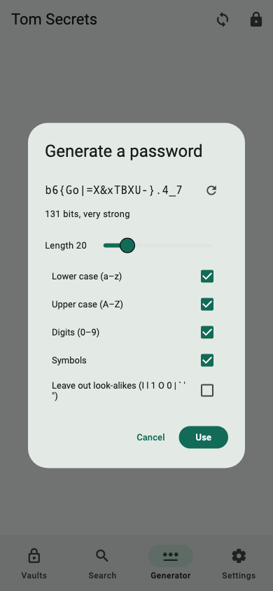

**To change an entry:** open it, change the fields and choose "Save".

Each save is written to GitHub at once. When another device changed the
vault meanwhile, both changes are merged; a change both made to the same
field shows as "*N* conflicts to settle" at the top of the Vaults list. Tap
it, then settle each field as on the desktop: keep one side's value or
write the value.

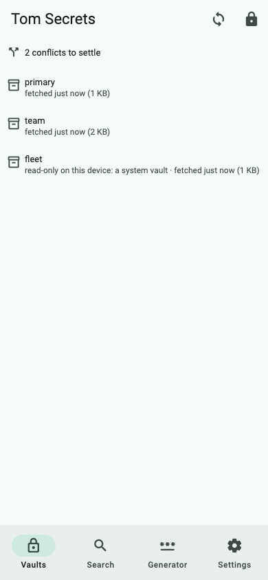

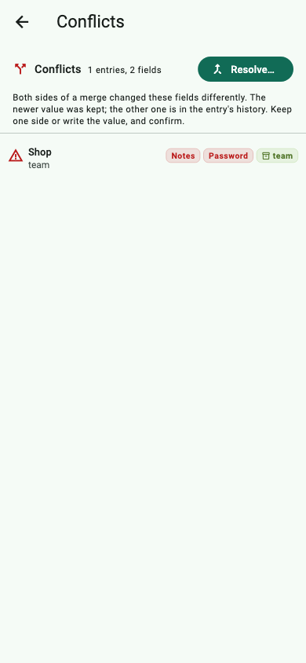

**To add a one-time code (TOTP):**

1. Switch on two-factor sign-in at the service; it shows a QR code or a
   secret.
2. In the entry's "One-time code" section, choose **"Scan a QR code"** and
   point the camera at it, or paste the `otpauth://` URI or the secret
   (the setup key: base32, or hex with `hex:` before it).
3. Choose "Save". The entry shows the current code with a copy button.

A code exported from Google Authenticator (`otpauth-migration://`) is read
when it holds one account; export the accounts one at a time. On the
desktop the same code is read from the screen, the clipboard or an image
file:
[setting up a one-time code](../../tom_secrets_app/doc/user_guide.md#setting-up-a-one-time-code).

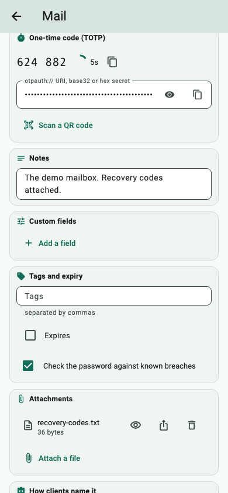

**To attach a file:** in the entry's Attachments section, choose "Attach a
file", pick it in Files (iOS) or the system's file picker (Android), and
save.

**To hand an attachment to another app:** choose the share button beside
it; the system's share sheet opens, to open or save it there. The shared
copy is removed when you close the share sheet (iOS) or at the next share
(Android).

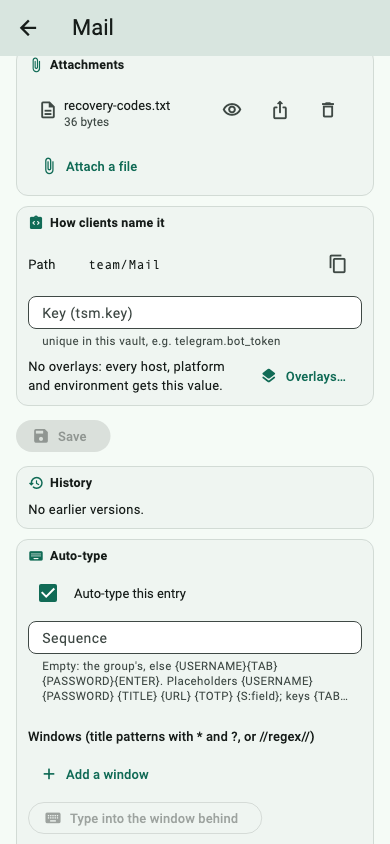

**A change not written yet.** Without a connection a save is kept in the
app's memory, and the vault shows "1 change not written to GitHub". The
next time the app reaches GitHub it writes it, merged with what other
devices changed meanwhile. Until then the change exists only in the running
app: the lock button asks ("Not written to GitHub"): "Write now" tries
again, "Discard" drops it (the phone keeps no copy).

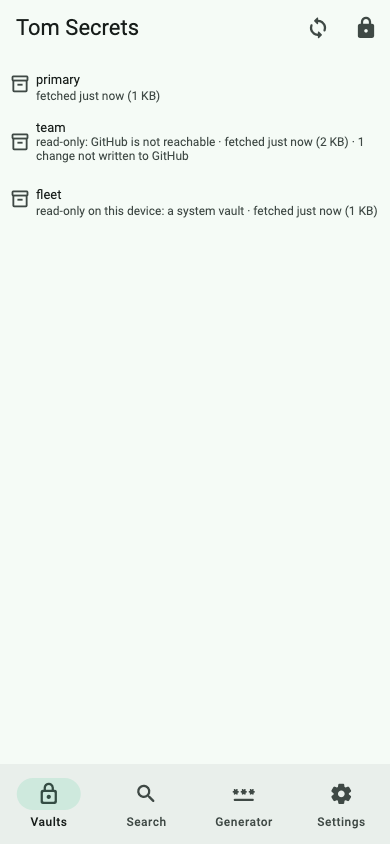

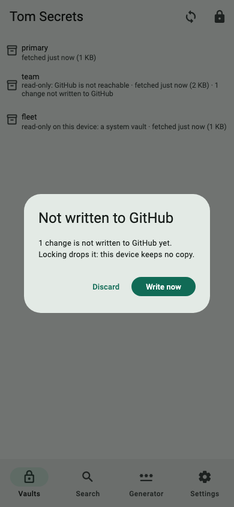

## Vaults in Files

A KDBX file of your own — in iCloud Drive, On My iPhone, or Google Drive and
the like on Android (the Storage Access Framework) — can be a vault on the
phone.

**To add a vault from a file:**

1. Open **Settings** and choose **"Add a vault from a file"**.
2. Pick the file in Files (iOS) or the system's file picker (Android).
3. Give the vault a name and type its password; choose "Add".

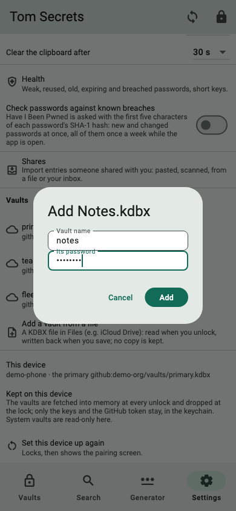

The phone reads the file into its memory when you unlock and writes it back
when you save; when it changed meanwhile (edited on the Mac, say), both
changes are merged. No copy is kept on the phone.

The vault is listed in your primary vault with its password, as every vault
is, under a name of this phone (`file:/tsm-document/<phone>/<file name>`):
your desktops and other phones list it, but cannot reach the file. Settings
lists every vault with where it is.

## Staying current

While the app is open and unlocked it looks on GitHub for changes:

- every few minutes: 15 by default, Settings › "Look for changes on GitHub
  every";
- when you come back to it;
- **to refresh by hand:** pull a list down, or choose the sync button at
  the top.

In the background, until the app locks, it goes on looking, read-only: a
change made on another device comes into the vaults the app holds, so they
are current when you come back. It writes nothing then: an edit that could
not reach GitHub is written when you return. Android lets the app go on
while it keeps it running; iOS pauses it within seconds, so on an iPhone
the look happens when you return. Nothing happens while the app is closed
or locked. The flows document draws
[the phone's refresh](https://github.com/al-the-bear/tom_secrets_manager/blob/main/doc/flows.md#the-phones-refresh).

**New keys of your own vaults.** When the desktop app runs a guided rotation
of a vault's keys, the phone takes the new key the next time it unlocks or
refreshes, and the desktop's Keys screen stops listing it as missing.

**To take up a rotated key:** while the desktop says the rotation is
prepared, open and unlock the app once. After the desktop switched, the
phone opens the vaults with the new key by itself. A phone that never took
it opens no vault re-keyed under it: set it up again by pairing.

**New keys of a shared vault.** Shared vaults (vaults you share with other
people) open on the phone like your own. When a member is removed from one
and the vault gets a new key, the phone takes up the new key at its next
unlock by itself, with your member key, and writes it into your primary
vault; nothing is asked. Creating a shared vault, opening someone
else's and adding or removing members happen in the desktop app.

## Autofill on Android

Android shows the app by its short name, "Tom Secrets".

**To turn it on:**

1. Open **Settings** › "Autofill service" and choose "Turn on".
2. The system's choice of the autofill service opens: pick "Tom Secrets".

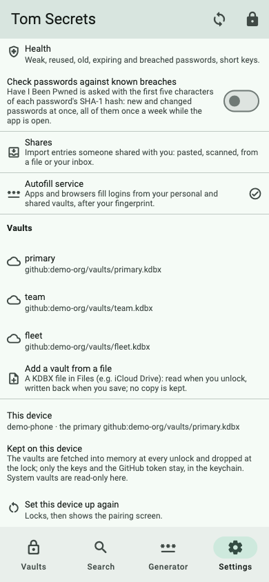

**To fill a login in an app or a browser:**

1. Tap the login field. Android offers "Unlock Tom Secrets Manager" (in the
   keyboard's strip where the keyboard shows suggestions).
2. Choose it:
   - with the app open and unlocked, your fingerprint (or the screen lock)
     confirms;
   - otherwise the app's unlock opens, fetches your vaults from GitHub, and
     nothing is kept once it closes. Without a connection it says so and
     fills nothing.
3. Choose the login of that app or site; Android fills it.

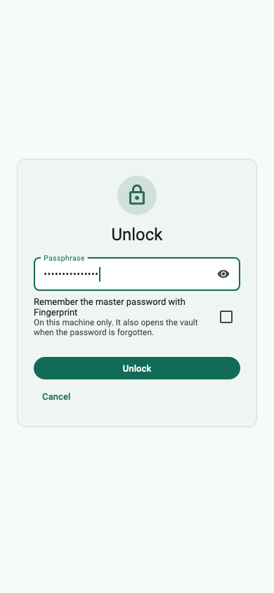

Only logins of your personal and shared vaults are offered, never a system
vault's. A login found by the app's name alone is marked "unverified app"
unless the site the login belongs to names that app (its Digital Asset
Links): check that it is the app you think.

When nothing matches, or the app is not set up yet, the service says so
instead of a list.

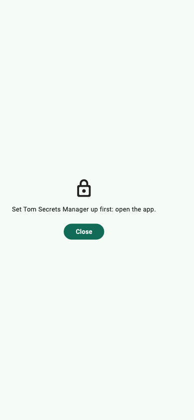

**To save a new login:** when you sign in with a login the vaults do not
hold, Android asks whether to save it in Tom Secrets. The app opens with
the banner "A login to save": choose "Review", then save it as a new login
in a vault, update the existing one, or drop it.

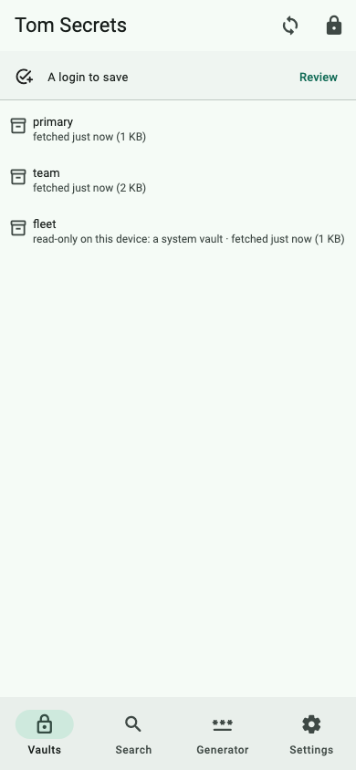

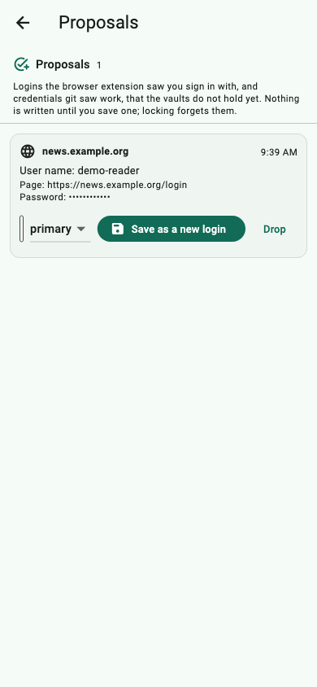

## Passkeys on Android

On Android 14 and later Tom Secrets keeps and uses passkeys.

**To turn it on:** in the phone's Settings › Passwords, passkeys & accounts,
add "Tom Secrets" as a service for passkeys.

**To sign in with a passkey:** a site or app that asks for one lists yours
from Tom Secrets. Pick one, and your fingerprint (or the screen lock)
confirms. When the app is not open and unlocked, its unlock opens first. A
passkey made on another device since this phone was last unlocked shows as
"Unlock Tom Secrets" first.

**To create a passkey:** when a site creates one, choose "Tom Secrets". The
passkey goes into the login of that site in your vaults, or into a new
login. It is saved to GitHub at once, so every device has it.

Only passkeys of your personal and shared vaults are used, never a system
vault's. An app may use a site's passkeys only when the site names that
app; otherwise the app says which site does not name it.

 The flows document draws
[passkeys on Android](https://github.com/al-the-bear/tom_secrets_manager/blob/main/doc/flows.md#on-android).

## Health

**To see what needs attention:** open Settings › **"Health"**. It lists, as
on the desktop (its user guide has the details), weak, reused, old (one
year by default, "Old after" above the list), expiring and breached
passwords, and short SSH keys. A line opens its entry.

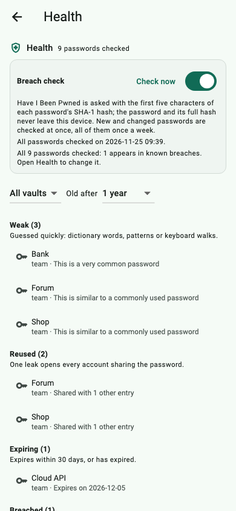

The **breach check** is on unless you turn it off: it asks Have I Been Pwned
with only the first five characters of each password's SHA-1 hash, so the
password never leaves the phone. It checks new and changed passwords at
once and all of them once a week, while the app is open and unlocked (a
phone runs no check in the background). Each run shows its result at the
bottom of the screen with **"Turn off breach check"**. "Exclude" next to a
breached login keeps it out of the check.

## Shares

Someone can share entries with you as an encrypted package (shares are sent
from the desktop app; its user guide has the details).

**To import a share you were given:**

1. Open Settings › **"Shares"** › **"Import a share…"**.
2. Paste the text, open the file, or **"Scan QR code"** with the camera; a
   share under a passphrase asks for it. The dialog says who sent it.
3. Choose **"Import into…"** and the vault and group.

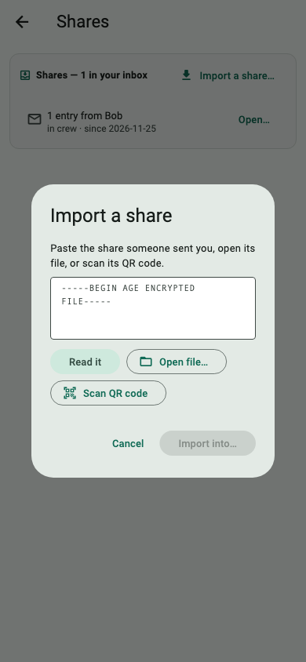

Shares put into your inbox in a shared vault, or into your mailbox on the
relay server a shared vault names as its mailbox, are found when the phone
unlocks or refreshes: a banner names them ("1 entry from Bob") with
**"Open"**, and the Shares page lists them.

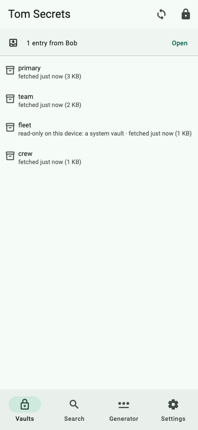

**To take a share from the inbox:**

1. Choose "Open" on the banner, or Settings › "Shares".
2. Choose **"Open…"** on the package, then **"Import into…"** and the vault
   and group. The package is deleted from the inbox or the relay.

**"Decline"** deletes a package unimported. Packages older than 30 days are
deleted on their own.

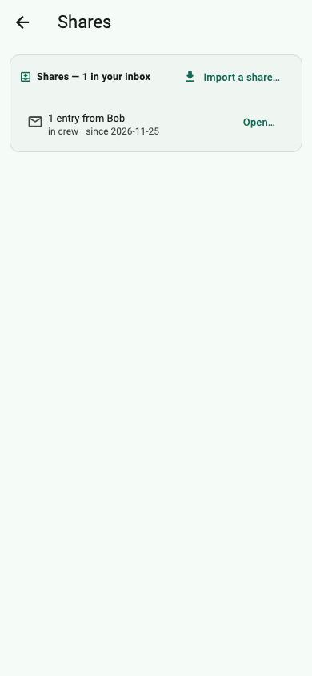

## Settings

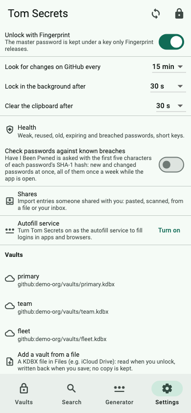

- **"Unlock with Face ID"** (or Touch ID, your fingerprint): on by default.
  Turned off, the key kept behind it is forgotten and every unlock asks for
  the master password.
- **"Look for changes on GitHub every"**: 5, 15, 30 or 60 minutes.
- **"Lock in the background after"**: at once, 30 seconds, 1 or 5 minutes.
- **"Clear the clipboard after"**: 15, 30, 60 or 120 seconds.
- **"Health"**: the [Health](#health) screen.
- **"Check passwords against known breaches"**: the breach check, on by
  default.
- **"Shares"**: importing a share, and your inbox ([Shares](#shares)).
- **"Autofill service"** (Android): whether Tom Secrets fills logins in
  apps and browsers, and "Turn on".
- **"Vaults"**: every vault with where it is (`github:…` or a file; "not
  reachable on this device" for another phone's file), and "Add a vault from
  a file".
- **"This device"**: its name and the primary vault.
- **"Kept on this device"**: what stays on the phone (the keys and the
  GitHub token, in the keychain).
- **"Set this device up again"**: locks and goes back to the setup screen.

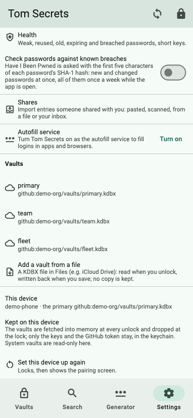

Where each setting is kept and its default are in the
[configuration reference](https://github.com/al-the-bear/tom_secrets_manager/blob/main/doc/configuration.md#the-mobile-app).

## The token reminder and setting up again

The phone's GitHub token comes from the pairing and expires on the date the
desktop gave it. Two weeks before, the Vaults list shows "A key is due"
with the token: "Snooze" puts it off; "Settings" opens Settings.

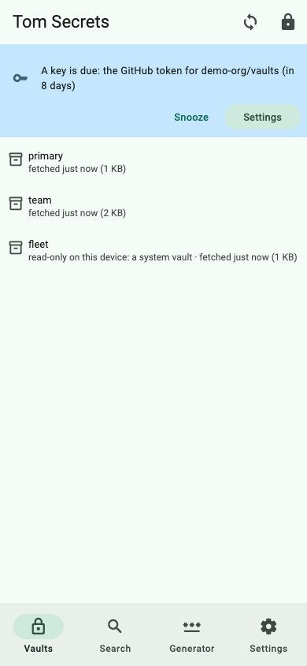

**To give the phone a new token** (before it expires, or after GitHub
refused it):

1. On the desktop, make a new fine-grained token for this phone.
2. On the phone, choose Settings › **"Set this device up again"** and
   confirm "Set up again" (or, on the unlock screen, **"Set this device up
   again"** below the unlock form). The vaults stay on GitHub.
3. Pair again with the desktop, which gives the phone the new token.

When GitHub refused the token, the unlock says so and a vault shows
"GitHub refused this device's token: Settings › Set this device up again".

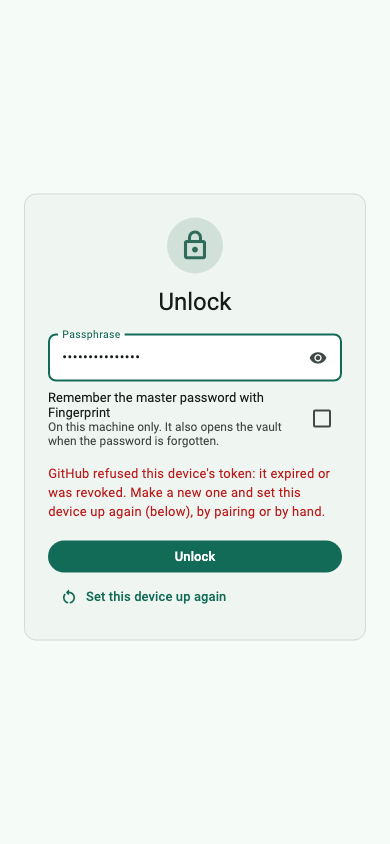

Setting up again is also the way after the keys were rotated on the desktop
while this phone did not take them.

## Troubleshooting

- **"No connection: the vaults are only on GitHub"**: connect to the
  internet; the phone has no copy to open, and the unlock is tried again by
  itself.
- **"GitHub refused this device's token"**: set the phone up again
  ([above](#the-token-reminder-and-setting-up-again)).
- **"Wrong code: the desktop closed its pairing window"**: open a new pairing
  window on the desktop and type its new code.
- **"The desktop declined"**: nothing was received; pair again and choose the
  vaults on the desktop.
- **"The camera is not allowed"**: allow it in the system's settings for
  the app, or type the code instead.
- **The master password is asked although Face ID is on**: the enrolment
  changed or the password was changed elsewhere; type it once and Face ID is
  used again.
- **The app does not start on an iPhone**: the 7-day build expired; install
  it again from Xcode ([Installing](#installing)).
