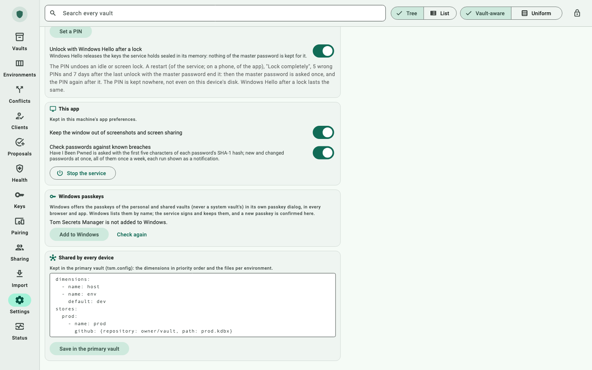
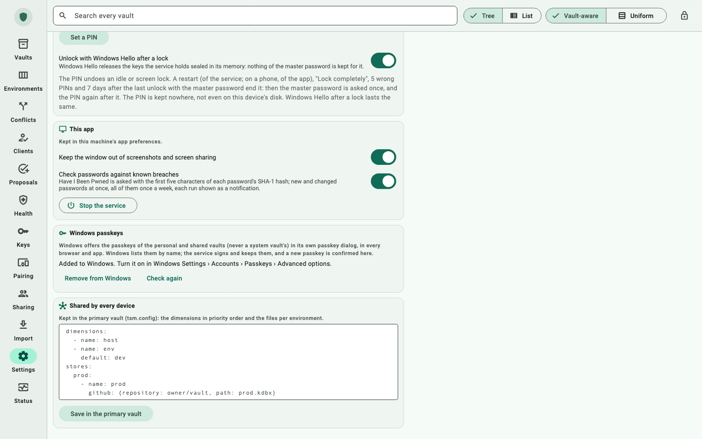
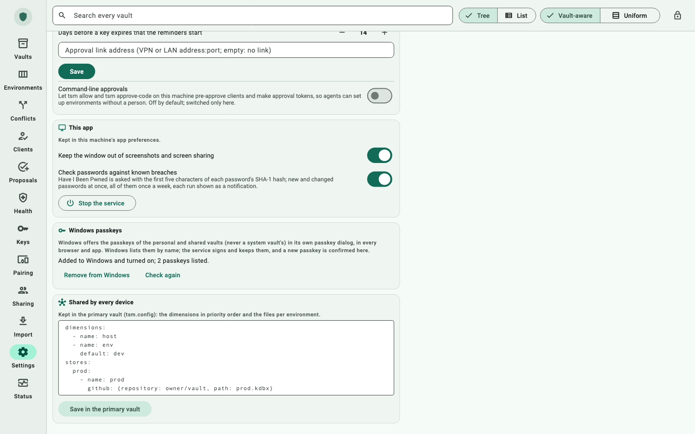
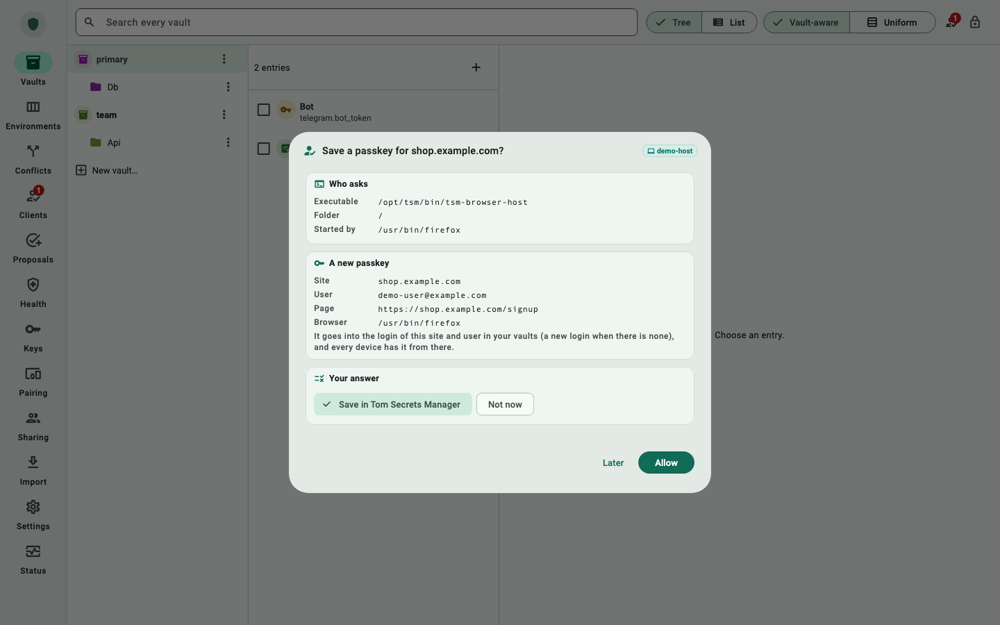

# Windows passkeys with Tom Secrets Manager: user guide

This guide is for the person who wants Windows to use the passkeys in their
Tom Secrets Manager vaults: in Edge, Chrome, Firefox and every app that
signs in with Windows' own passkey dialog. The labels in quotes are the
ones the app and Windows show. The [package README](../README.md) is the
developers' reference.

It needs Windows 11 24H2 (build 26100) or later, and the manager app
installed from its MSIX package.

## Contents

- [How it works](#how-it-works)
- [Installing](#installing)
- [Turning it on](#turning-it-on)
- [Signing in with a passkey](#signing-in-with-a-passkey)
- [Creating a passkey](#creating-a-passkey)
- [When Tom Secrets Manager is locked](#when-tom-secrets-manager-is-locked)
- [Removing it](#removing-it)
- [Troubleshooting](#troubleshooting)

## How it works

This diagram shows what answers when a site asks Windows for a passkey.



<!-- diagram 1-pieces
```mermaid
flowchart LR
  site["A site or app<br/&gt;asks for a passkey"]:::client
  subgraph win["Windows"]
    dialog("Windows' passkey dialog"):::external
    plugin("Tom Secrets Manager's<br/&gt;passkey plugin"):::program
  end
  svc("Secrets service"):::program
  app("Manager app"):::program
  vaults[("Vaults")]:::vault
  site --&gt; dialog
  dialog -- the passkey you picked --&gt; plugin
  plugin -- passkeys, sign, create --&gt; svc
  svc -- approval, Save a passkey? --&gt; app
  svc --&gt; vaults
  class win zoneDevice
```
-->

- **Windows' dialog** is where you pick a passkey or confirm a new one; it
  always shows, also for Tom Secrets Manager's passkeys.
- **The plugin** (`tsm-passkey-plugin.exe`) comes with the app and is
  started by Windows. It holds no key: it passes Windows' request to the
  service and the answer back.
- **The service** keeps the passkeys in your personal and shared vaults
  (never a system vault's) and signs with them; a passkey's key never
  leaves it.
- **The app** asks you when it must: the first sign-in, and every new
  passkey.

## Installing

The plugin is part of the manager app's MSIX package
(`tom_secrets_manager-<version>-windows-x64.msix`); Windows accepts a
passkey plugin only from an installed package. The package is signed with
a self-signed certificate, which each machine trusts once.

**To install:** trust the certificate (an administrator, once per
machine), then open the package and choose "Install"; the app's user guide
has the steps:
[installing from the MSIX package](../../tom_secrets_app/doc/user_guide.md#installing-and-first-start).
Then start the app and set it up (its First run).

## Turning it on

Two switches, one in the app and one in Windows.

**To turn Windows passkeys on:**

1. In the app, open Settings › Integrations › "Windows passkeys" and
   choose "Add to Windows".

   

2. The section now says "Added to Windows. Turn it on in Windows Settings ›
   Accounts › Passkeys › Advanced options."

   

3. In Windows, open Settings › Accounts › Passkeys › Advanced options and
   switch on "Tom Secrets Manager".
4. Back in the app, choose "Check again": it says "Added to Windows and
   turned on" with the number of passkeys listed.

   

From then on the app gives Windows the names of your passkeys (site and
user name, never a key) after every unlock and every change, so Windows can
list them in its dialog.

## Signing in with a passkey

**To sign in:**

1. On the site or in the app, choose to sign in with a passkey.
2. Windows' passkey dialog lists your passkeys for the site, Tom Secrets
   Manager's among them; pick one.
3. The first time, the manager app asks "Windows asks for passkeys": choose
   "Always". Windows' dialog then needs no further answer in the app for
   later sign-ins.
4. The site signs you in.

The app's prompt is the check that it is you; the plugin shows no Windows
Hello prompt of its own.

## Creating a passkey

**To create a passkey in your vaults:**

1. On the site, choose to create a passkey.
2. In Windows' dialog, choose Tom Secrets Manager.
3. The app asks "Save a passkey for <site>?", naming the site and the user;
   choose "Save in Tom Secrets Manager".

   

4. The passkey is kept in the login of that site and user (or a new login)
   before the site gets its answer, and every device has it from there.

Every new passkey is confirmed this way. "Not now" refuses it: Windows
tells the site it was cancelled. A site that already has a passkey of
yours for that account is told so.

## When Tom Secrets Manager is locked

Windows asks the plugin whether it is ready. While the service is locked
(or not running), the plugin answers that it is not ready, and Windows says
so in its dialog and offers to try again.

**To use your passkeys then:** unlock the app (master password, or Windows
Hello once set up), then choose to try again in Windows' dialog. The
passkey names stay listed in Windows while locked.

## Removing it

**To remove it:** in the app, Settings › Integrations › "Windows passkeys",
choose "Remove from Windows". The plugin leaves Windows, with the passkey
names Windows listed; the passkeys themselves stay in your vaults.

## Troubleshooting

The plugin writes what failed (never a value, a key or a passkey) to
`%LOCALAPPDATA%\TomSecretsManager\passkey-plugin.log`. Paste that folder
into Explorer's address bar to open it.

| What you see | Why | What to do |
| --- | --- | --- |
| Tom Secrets Manager is not in Windows' Advanced options | the plugin was not added | choose "Add to Windows" in the app |
| the section shows an error in red from the plugin | the plugin's own message: for example Windows before 24H2, which has no passkey plugins | act on the message; update Windows |
| "Add to Windows" fails with `0x80073D54` | the app was not installed from its MSIX package | install the package (above) |
| Windows says the authenticator is not ready | the service is locked or not running | unlock the app and try again |
| Windows' dialog closes without signing in | you answered no in the app, or the vaults hold no passkey for the site | sign in again and choose "Always" in the app |
| a site says a passkey exists already | your vaults hold one for that account | sign in with it instead |
| Windows' list misses a new passkey | the names are handed to Windows at unlock and after changes | lock and unlock the app, or choose "Check again" |

The flows draw this route and the passkey routes of the browser extension,
macOS and Android:
[on Windows through the plugin](https://github.com/al-the-bear/tom_secrets_manager/blob/main/doc/flows.md#on-windows-through-the-plugin).
