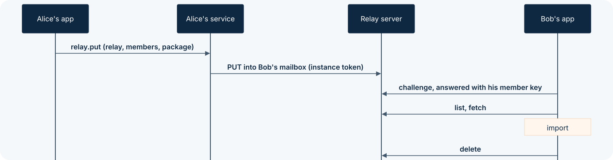

# The relay server: operator's guide

This guide is for the person who hosts a Tom Secrets Manager relay server
(`tom_secrets_relay`) for a team or for themselves: what it does, how to
build, configure and deploy it behind a reverse proxy, how it protects
itself, and how to keep it running. The package's [README](../README.md)
is the reference for its endpoints; every setting is in the
[configuration reference](https://github.com/al-the-bear/tom_secrets_manager/blob/main/doc/configuration.md#the-relay-servers-relayyaml).

The blocks starting with `$` are real exchanges with a relay started by the
package's tests, shown as `curl -i` against `https://relay.example.org`.

## Contents

- [What a relay does and does not see](#what-a-relay-does-and-does-not-see)
- [Building it](#building-it)
- [Configuring it](#configuring-it)
- [Token mode and open mode](#token-mode-and-open-mode)
- [Address lists](#address-lists)
- [Limits and blocks](#limits-and-blocks)
- [Behind a reverse proxy](#behind-a-reverse-proxy)
- [Health checks](#health-checks)
- [Storage and expiry](#storage-and-expiry)
- [Logs](#logs)
- [Upgrading](#upgrading)
- [The alternative: a magic-wormhole server](#the-alternative-a-magic-wormhole-server)

## What a relay does and does not see

Two of the user's devices normally reach each other directly: on the same
network or over a VPN. A relay carries their traffic when they cannot. It
serves three things:

- **Pairing:** a new device and the giving app meet on a numbered
  nameplate for 10 minutes; the relay joins the two WebSockets.
- **The approval link:** a server and the desktop that approves its
  prompts meet on a random link id and stay joined.
- **The mailbox:** a member puts an entry shared with another member into
  that member's mailbox, where it waits up to 30 days.

This diagram shows where the relay sits between two devices, and what
passes through it.



<!-- diagram 1-relay-between-devices
```mermaid
flowchart LR
  subgraph a["Device A"]
    appa("App, service"):::program
  end
  subgraph remote["The internet"]
    relay["Relay server"]:::external
    box["Mailbox items<br/&gt;age packages"]:::file
  end
  subgraph b["Device B"]
    appb("App, service"):::program
  end
  appa -- pairing, link: encrypted frames --&gt; relay
  relay -- pairing, link: encrypted frames --&gt; appb
  appa -- put --&gt; box
  box -- list, fetch with the proof --&gt; appb
  relay --- box
  class a zoneDevice
  class b zoneDevice
  class remote zoneRemote
```
-->

**The relay sees only ciphertext.** The pairing (SPAKE2 with ML-KEM-768)
and the link (Noise KK with ML-KEM-768) run their handshakes end to end
inside the relay's channels; a mailbox item is an `age` package encrypted
to the recipient's member key. The relay never learns the pairing code, a
secret, a vault or a key. It does see the addresses that connect, when,
how much they send, and which mailbox (a fingerprint) an item is for. It
imports no vault format.

## Building it

**To build the container image:** from the `tom_app_secrets_manager`
repository's `tom_secrets_build`, run `./ci.sh :relay` (needs a running
Docker). It builds the package's `Dockerfile` and tags the image
`tom_secrets_relay:<version>`. Or, in the `tom_secrets_relay` folder:

```sh
docker build -t tom_secrets_relay .
```

The image is the AOT-compiled relay and `tom_pqc`'s native library on
`scratch`, with the Dart image's runtime libraries; it runs as uid 65532
and checks its own health.

**To run the AOT bundle without a container:**

```sh
dart build cli -t bin/tom_secrets_relay.dart -o build/relay
build/relay/bundle/bin/tom_secrets_relay config=relay.yaml
```

Keep `bundle/bin` and `bundle/lib` together: the executable loads
`tom_pqc`'s library from `lib/`. `dart compile exe` does not build that
library.

## Configuring it

The relay reads `relay.yaml`: named by `config=<file>`, else by
`TSM_RELAY_CONFIG`, else `./relay.yaml`. The package's `relay.example.yaml`
lists every setting with its default. The top level holds the server's own
keys; the relay's are under `relay:`.

```yaml
port: 47910
host: 127.0.0.1           # behind the reverse proxy, on the loopback
logLevel: production      # info, warnings, errors

relay:
  mode: token
  tokens:
    team-a: <a long random token>
  deny: []
  allow: []
  trustedProxies: [127.0.0.1, '::1']
  storage: /data
```

The environment and `key=value` arguments override the file. The full
table, every key with its type and default, is the configuration
reference's
[relay section](https://github.com/al-the-bear/tom_secrets_manager/blob/main/doc/configuration.md#the-relay-servers-relayyaml).

## Token mode and open mode

| Mode | Mailbox puts and approval links | Pairing | Reading a mailbox |
| --- | --- | --- | --- |
| `token` (the default) | only with an instance token | open to anyone | the recipient's proof |
| `open` | open to anyone, limited per address | open to anyone | the recipient's proof |

Use token mode unless the relay is only reachable by your own devices. A
relay in token mode without tokens starts, warns, and refuses every put
and link:

<!-- transcript put-without-token -->
```text
$ curl -i -X PUT -H 'Tsm-Expires: 2026-12-01T00:00:00Z' --data 'age-encryption.org/v1' https://relay.example.org/v1/mailbox/abcdefghijklmnopqrstuvwxyz234567abcdefghijklmnopqrst/item-1
HTTP/1.1 401
content-type: application/json

{"error":"this relay accepts mailbox items only from holders of an instance token: add the token to the relay in the app's relay settings (the operator sets the tokens under relay.tokens, or relay.mode: open)"}
```

Reading a mailbox needs the recipient's proof in either mode: the relay
answers a challenge with a token encrypted to the recipient's member key,
which only the member can decrypt.

This diagram shows the mailbox's exchange: the sender's service puts the
package with its instance token; the recipient proves its member key, then
lists, fetches and deletes.



<!-- diagram 2-mailbox
```mermaid
sequenceDiagram
  participant A as Alice's app
  participant S as Alice's service
  participant R as Relay server
  participant B as Bob's app
  A-&gt;&gt;S: relay.put (relay, members, package)
  S-&gt;&gt;R: PUT into Bob's mailbox (instance token)
  B-&gt;&gt;R: challenge, answered with his member key
  B-&gt;&gt;R: list, fetch
  Note over B: import
  B-&gt;&gt;R: delete
```
-->

<!-- transcript list-without-proof -->
```text
$ curl -i https://relay.example.org/v1/mailbox/abcdefghijklmnopqrstuvwxyz234567abcdefghijklmnopqrst
HTTP/1.1 401
content-type: application/json

{"error":"the mailbox needs the recipient's proof: POST /v1/mailbox/<recipient>/challenge, then the decrypted token as Authorization: Bearer"}
```

**To make an instance token:** give each team or user their own, at least
16 characters, for example from `openssl rand -base64 32`, and name it in
`relay.tokens`:

```yaml
relay:
  tokens:
    team-a: <the token>
    alice: <another token>
```

The name appears in the logs and the per-token limits. Write the token
itself: the relay resolves no `secret:` reference and refuses one at start.
So `relay.yaml` holds secrets; make it readable only by the relay (mode
0600, mounted read-only into the container).

**To hand a token out:** send it to the team over a channel you trust. Each
member enters it once: in the desktop app's Sharing › Relays (the key
button beside the relay), or on a server with
`tsm pair --relay tsm:https://relay.example.org --token-env VAR`. The
service keeps it in the device's keychain. To withdraw a token, remove it
from `relay.tokens` and restart the relay.

## Address lists

`relay.deny` and `relay.allow` are lists of CIDR ranges (IPv4 and IPv6),
checked before anything else. A denied address gets 403; with `allow` set,
only the addresses in it are admitted.

```yaml
relay:
  deny: [203.0.113.0/24]
  allow: [198.51.100.0/24, '2001:db8::/32']
```

The address is the client's: behind a proxy, the one in `X-Forwarded-For`,
believed only from the addresses in `relay.trustedProxies`.

## Limits and blocks

**Limits** answer 429 with `Retry-After` (seconds) and a message saying
which limit; the apps and `tsm` wait that long and try once more:

| What | Limit | Key |
| --- | --- | --- |
| nameplates | 10 per address per hour, 10 minutes each | `pairing.*` |
| a pairing channel | 64 KB per frame, 1 MB in all | `pairing.*` |
| approval links | 10 open per token, 64 KB per frame, 24 hours alone | `link.*` |
| mailbox puts | 30 per token per hour (open mode: per address) | `mailbox.putsPerHour` |
| a mailbox item | 1 MB, at most 30 days | `mailbox.*` |
| a recipient | 200 items or 50 MB | `mailbox.*` |
| proof challenges | 20 per recipient per hour, valid 5 minutes | `proof.*` |

<!-- transcript rate-limited -->
```text
$ curl -i -X POST https://relay.example.org/v1/pair
HTTP/1.1 429
content-type: application/json
retry-after: 3600

{"error":"at most 10 nameplates per address per hour"}
```

**Denial-of-service blocks** stop an address that floods the relay: more
than 10 requests in a second, 120 in a minute or 2,000 in a day (the
`dos.*` keys) blocks it. A blocked address's connections are closed
without an answer: 24 hours the first time, 48 the second, a week the
third, each further block twice the one before (`dos.blockHours`); a past
block counts for 90 days (`dos.rememberDays`). The block list is kept in
the storage directory, so a restart lifts no block. `/health` and `/ready`
are not counted.

The apps pace themselves at about half of these limits (5 requests a
second, 60 a minute, 1,000 a day per relay), so a device's normal use
never comes near a block. A WebSocket the relay ends gets a close code from
4000 (the README lists them), for example 4429 for too many links.

**To lift a block:** stop the relay, remove the address's entry from the
block list in the storage directory, and start it again.

## Behind a reverse proxy

The relay speaks plain HTTP. Put it behind a reverse proxy that terminates
TLS, forwards the WebSockets and adds `X-Forwarded-For`.

This diagram shows the deployment: the proxy in front, the relay on the
loopback, its configuration and storage on the host.



<!-- diagram 3-reverse-proxy
```mermaid
flowchart LR
  devices["Devices<br/&gt;apps, services, tsm"]:::client
  subgraph host["The relay's host"]
    proxy["Apache<br/&gt;TLS, port 443"]:::external
    relay("tom_secrets_relay<br/&gt;127.0.0.1:47910"):::program
    conf["relay.yaml"]:::file
    data["Storage<br/&gt;mailbox, block list"]:::file
  end
  devices -- HTTPS, WebSockets --&gt; proxy
  proxy -- HTTP, X-Forwarded-For --&gt; relay
  conf --&gt; relay
  relay --&gt; data
  class host zoneDevice
```
-->

**An Apache example** (2.4.47 or later, with `mod_proxy`, `mod_proxy_http`
and `mod_ssl`), for the relay on the loopback port 47910:

```apache
<VirtualHost *:443>
  ServerName relay.example.org
  SSLEngine on
  SSLCertificateFile    /etc/ssl/relay.example.org/fullchain.pem
  SSLCertificateKeyFile /etc/ssl/relay.example.org/privkey.pem

  ProxyRequests Off
  ProxyPreserveHost On
  # The WebSockets: pairing channels and approval links. A link carries
  # nothing between prompts, so give it a long idle time.
  ProxyPass /v1/pair/ http://127.0.0.1:47910/v1/pair/ upgrade=websocket timeout=86400
  ProxyPass /v1/link/ http://127.0.0.1:47910/v1/link/ upgrade=websocket timeout=86400
  # Everything else: nameplates, the mailbox, the probes.
  ProxyPass        / http://127.0.0.1:47910/
  ProxyPassReverse / http://127.0.0.1:47910/
</VirtualHost>
```

- **`X-Forwarded-For`:** `mod_proxy_http` adds it. The relay believes it
  only from `relay.trustedProxies` (the loopback by default), so with the
  relay on the loopback the default is right. In a container with a
  published port, trust the address the proxy's requests arrive from
  inside the container instead.
- **The idle time:** an approval link that the proxy closes is opened
  again by the approving device, but a long `timeout` avoids the churn.
- **The container** behind such a proxy, with host networking and bound to
  the loopback:

  ```sh
  docker run -d --name relay --network host --read-only --cap-drop ALL \
    -v /srv/relay/relay.yaml:/config/relay.yaml:ro \
    -v /srv/relay/data:/data \
    tom_secrets_relay
  ```

  with `host: 127.0.0.1` and `relay.storage: /data` in `relay.yaml`, the
  data folder owned by uid 65532.

Devices then use the relay as `tsm:https://relay.example.org`.

## Health checks

`GET /health` (and `GET /ready`) answer 200 while the relay runs:

<!-- transcript health -->
```text
$ curl -i https://relay.example.org/health
HTTP/1.1 200
content-type: text/plain; charset=utf-8

OK
```

`tom_secrets_relay health [config=<file>]` asks the running relay's
`/health` on the configured port (on the loopback when it listens on every
address) and exits 0 on 200, else 1; the image uses it as its
`HEALTHCHECK`, since `scratch` has no `curl`. `docker ps` shows the
result.

Every path the relay does not serve answers 404, the framework's own
services among them:

<!-- transcript unknown-path -->
```text
$ curl -i https://relay.example.org/admin
HTTP/1.1 404
content-type: application/json

{"error":"not found"}
```

## Storage and expiry

`relay.storage` (default `relay-data`, relative to the working directory;
`/data` in the container) holds:

- `mailbox/`: one file per item, with a JSON index per recipient;
- the block list.

Nameplates, pairing channels and links live in memory only.

<!-- transcript pair -->
```text
$ curl -i -X POST https://relay.example.org/v1/pair
HTTP/1.1 200
content-type: application/json

{"nameplate":"42","expires":"2026-11-24T09:10:00.000Z"}
```

**The expiry job** runs every `expiryMinutes` (10): it deletes the items
past their `Tsm-Expires` (at most `mailbox.maxExpiryDays`, 30 days, after
the put) and closes the nameplates past their 10 minutes. Members delete an
item themselves once they imported or declined it. Back up the storage
folder if you want the waiting items to survive the loss of the host; the
mailbox is a convenience, and a share can always be sent again.

## Logs

The relay logs to standard output (`docker logs relay` in a container),
at the level `logLevel` sets (`production`: info, warnings and errors).

- **Every request:** its method, route, status, size and duration; never a
  body.
- **The relay's own lines**, starting with `relay:`:
  - `relay: listening on port 47910 (token mode, 2 instance tokens)` at
    start;
  - `relay: token mode without instance tokens: every mailbox put and
    approval link is refused…` (a warning) when it has none;
  - `relay: put 1532 bytes for abcdefgh (token team-a)` for a mailbox put,
    a recipient shown only by its first 8 characters;
  - `relay: abcdefgh deleted an item`;
  - `relay: expired 3 mailbox items and 1 nameplates` from the expiry job;
  - `relay: blocked an address (block 1, 24 hours): more requests than
    the denial-of-service limits allow` (a warning);
  - `relay: the block list … cannot be read; it starts empty` (a
    warning).

## Upgrading

**To upgrade:**

1. Build the new image (`ci.sh :relay`, or `docker build`).
2. Replace the container: stop and remove the old one, start the new one
   with the same `relay.yaml` and storage volume.
3. Check `/health` and the start line in the log.

The mailbox and the block list survive in the storage folder. A restart
ends the pairings in progress (their WebSockets close with 4503, the relay
stops) and the open links, which the approving devices open again. Upgrade
when no one is pairing.

## The alternative: a magic-wormhole server

For pairing alone, the apps and `tsm pair` can use a magic-wormhole mailbox
server instead of a relay server (`wormhole:ws://…`): the magic-wormhole
project's public one (`ws://relay.magic-wormhole.io:4000/v1`) or one you
run yourself (`magic-wormhole-mailbox-server`), unchanged. It needs no
token and carries only the pairing's encrypted messages, under the app's
own application id. It offers no approval link and no mailbox. The public
one is run by volunteers and is not always up; a relay server of your own
is the dependable choice.

The flows draw the pairing and the approval link through a relay server
too:
[the flows document](https://github.com/al-the-bear/tom_secrets_manager/blob/main/doc/flows.md).
